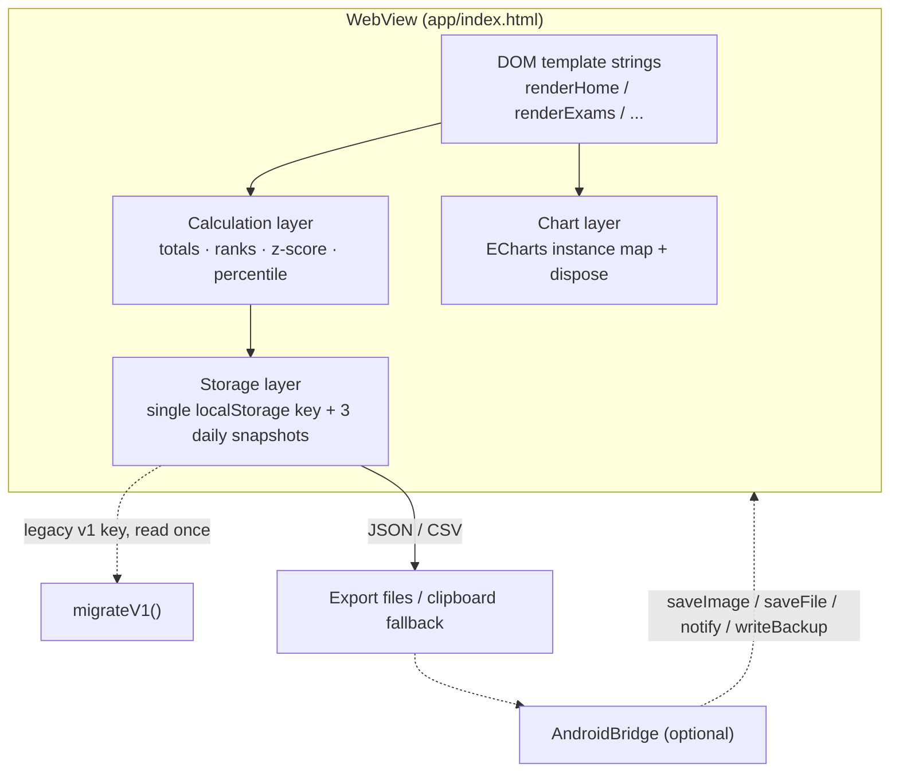

<div align="center">


# GradeTracker

**A fully offline Android grade manager — single-file WebView frontend + surgical APK repack toolchain**

No sign-up · No network · No telemetry · Your data stays on your own phone

<sub>[简体中文](README.md) · **English** · [日本語](README.ja.md) · [한국어](README.ko.md) · [Español](README.es.md) · [Русский](README.ru.md)</sub>

[](LICENSE)
[](https://github.com/axsdfg/GradeTracker/releases/latest)
[](https://github.com/axsdfg/GradeTracker/actions/workflows/ci.yml)
[](#system-requirements)
[-059669.svg)](docs/PRIVACY.md)
[](test/)
[](app/index.html)

</div>

---

> **Documentation language** — This is the full English edition. The Chinese edition is [README.md](README.md); detailed guides under [`docs/`](docs/) are currently written in Chinese, and English translations are welcome.

## Table of contents

- [What it is](#what-it-is)
- [Why it's interesting](#why-its-interesting)
- [Feature overview](#feature-overview)
- [UI layout](#ui-layout)
- [Quick start](#quick-start)
- [Data, backup and privacy](#data-backup-and-privacy)
- [Import and export formats](#import-and-export-formats)
- [Project layout](#project-layout)
- [Architecture](#architecture)
- [APK packaging and signing toolchain](#apk-packaging-and-signing-toolchain)
- [Testing](#testing)
- [Known limitations](#known-limitations)
- [Roadmap](#roadmap)
- [Contributing](#contributing)
- [License](#license)

---

## What it is

**GradeTracker** is a grade-recording tool built for high-school students to use themselves. The entire application is one HTML file (`app/index.html`, roughly 3,000 lines) running inside an Android WebView, with all data written to `localStorage`.

The problem it solves is concrete: report cards arrive as a photo or a message in a class group chat, and by the end of a term it is genuinely hard to tell "is this subject improving or slipping?". The app lets you record every exam — per-subject score, subject rank, overall rank — and then answers three questions:

1. Am I **improving or falling behind** across exams? (trend lines, with the rank axis inverted — higher on the chart means better)
2. **Which subject is my weakest link?** (cross-subject normalization plus a priority order for score gains)
3. **How far am I from my target score?** (target panel that color-codes the gap)

Beyond the app, the repository also ships an **APK repack toolchain that needs neither Android SDK nor Gradle**: drop the new HTML into an already-signed APK, patch the binary `AndroidManifest.xml` at byte level, rebuild ZIP alignment, and re-sign with `apksig`. It is meant for the case "all I have is an APK, no source project".

## Why it's interesting

A few engineering trade-offs here are unusual enough to be worth a look if you are building something similar:

| Trade-off | Notes |
|---|---|
| **Single-file frontend** | No build step, no `node_modules`, no framework. Edit a line, save, refresh. The cost: modularity by convention instead of `import` |
| **Zero permissions = privacy at the OS level** | The original package has **no `INTERNET` permission**. This is not a promise not to upload — the operating system makes it impossible. Nothing inside the WebView (including a swapped-in chart library) can reach the network |
| **The database is localStorage** | No Room, no SQLite. See [known limitations](#known-limitations) for the cost; the benefit is that a backup is just a JSON blob |
| **Surgical repackaging** | Nothing is rebuilt. Only `assets/index.html` is replaced and the manifest is patched; the other 395 ZIP entries stay byte-identical to the original |
| **The UI runs in Node** | The whole app runs under a DOM stub in Node, with all 34 regression steps passing — logic is verifiable without a browser |

## Feature overview

Status legend: ✅ implemented ｜ ⚠️ has a fallback path ｜ ❌ requires native-side work; the frontend interface is already in place

### Grade management

| Feature | Status | Notes |
|---|---|---|
| Exam records | ✅ | Name, date, type (monthly / midterm / final / mock…), overall class and grade rank, notes |
| Per-subject score and rank | ✅ | 9 configurable subjects (3 core + 3 of 6 electives), full marks per subject, subject-level class and grade rank |
| Subject visibility | ✅ | Hide unused subjects; they are excluded from statistics and charts |
| Term / year archiving | ✅ | Exams belong to a term, switchable via a capsule in the header; create, rename, delete empty terms |
| Automatic migration | ✅ | On first open, v1 data (`grade_tracker_data`) is moved into the v2 structure; the old key is **kept as-is, never deleted** |

### Analysis

| Feature | Status | Notes |
|---|---|---|
| Rank trend / progress curve | ✅ | Line chart for total or a single subject (with a dashed full-marks line); dual lines for class and grade rank, inverted axis |
| Subject strength | ✅ | Score rate as a cross-subject normalizer; horizontal bars plus a priority order for score gains |
| Ability radar | ✅ | This exam vs personal average — the direction of any imbalance is obvious at a glance |
| Target tracking | ✅ | Target score vs actual per subject, signed gap, progress bar, count of subjects on target |
| Score-to-rank conversion | ✅ | Score → rank, number of students on the same score, rank band, percentile beaten; control-line comparison; 750-scale conversion |
| Parent view | ✅ | Hides ranks and percentile bands, showing only scores and trends |

### Records and tools

| Feature | Status | Notes |
|---|---|---|
| Mistake notebook | ✅ | Subject / linked exam / error category / correction / tags / mastery state, searchable and filterable (text only, no images) |
| Report-card image | ✅ | Drawn on a 1080×1500 canvas, one tap to save (native bridge saves to the gallery, otherwise a browser download) |
| Scoring modes | ✅ | Raw / weighted (Σ score × weight) / converted (score rate mapped onto an adjustable range) |
| Exam countdown | ✅ | Countdown on the home screen plus 3/7/14/30-day reminder strips (system notifications need the native bridge; otherwise in-page) |
| Dark mode | ✅ | Follow system / light / dark, with chart colors switching in sync |
| Interface language | ✅ | 简体中文 / English / 日本語 / 한국어 / Español / Русский, switchable in Settings or follow the system. Charts, the shareable report card and toasts are localized too |
| Data export | ✅ | Full JSON backup plus CSV score details (with BOM, so Excel opens it directly) |
| Table import | ✅ | Paste from Excel/WPS (TSV) or CSV; same date and same name merge into one exam automatically |
| Automatic backup | ✅ | Three on-device snapshots per day (ring buffer); five more files on disk when the native bridge is present |
| Home-screen widget | ❌ | Purely native capability (Glance / AppWidget) |
| Photo capture for mistakes | ❌ | Needs camera permission plus image storage; images would blow the localStorage quota |

## UI layout

Five bottom tabs, all inside the same HTML and switched by `switchView()`:

| Tab | Contents |
|---|---|
| **Home** | Current-term total, change since last exam, target panel, total-score trend, exam countdown |
| **Exams** | Exam list (filtered by term) → detail (per-subject score, rank, class comparison) |
| **Analysis** | Three sub-tabs: trend / strength / ranking |
| **Mistakes** | Mistake cards, filtered by subject and mastery state |
| **Settings** | Subject configuration, weights and conversion, term management, data source, export/import, theme, parent view |

## Quick start

### Option 1: Download the APK

[**Download the latest APK**](https://github.com/axsdfg/GradeTracker/releases/latest) · 3.37 MiB · Android 7.0+ · six UI languages

The first install asks the system to allow apps from unknown sources. This build is signed with a **debug certificate** — fine for installing on your own phone, but not recommended as an official distribution. For long-term maintenance, build it yourself with a release key (see Option 3).

> It carries the same signature as the previous version, so installing over it will not wipe existing grades. Checksums are on the [Releases](https://github.com/axsdfg/GradeTracker/releases) page.

### Option 2: Build an installable APK yourself

You need an **existing APK** (used as the shell) and JDK 17:

```bash
# 1. Replace the frontend and patch the manifest, producing an unsigned package
python tools/apk_repack.py original.apk app/index.html unsigned.apk

# 2. Re-sign (v1 + v2 + v3)
java tools/SignApk.java sign my.jks <storepass> <alias> unsigned.apk signed.apk 21

# 3. Verify
java tools/SignApk.java verify signed.apk      # expect verified = true, v1/v2/v3 all true
```

Details, pitfalls and manifest changes are in **[docs/PACKAGING.md](docs/PACKAGING.md)** (Chinese).

### Option 3: Embed it in your own Android project

Put `app/index.html` into `app/src/main/assets/`, load it with `WebViewAssetLoader` (steadier than `file://`), then wire up the JS bridge:

```java
webView.addJavascriptInterface(new Bridge(this), "AndroidBridge");
webView.loadUrl("https://appassets.androidplatform.net/assets/index.html");
```

A complete reference implementation of the native shell (14 KB, covering file picking, downloads, image saving, notifications and the back button) is in **[android/MainActivity.java](android/MainActivity.java)**; manifest changes and permissions are documented in **[docs/ANDROID-INTEGRATION.md](docs/ANDROID-INTEGRATION.md)** (Chinese).

### Option 4: Run it in a browser (development)

```bash
node scripts/fetch-vendor.js
node scripts/build-preview.js      # produces dist/preview.html (ECharts inlined into one file)
# then double-click dist/preview.html
```

You can also open `app/index.html` directly (requires `app/echarts.min.js` beside it).

> Browsers scope `localStorage` by origin, so `file://` and `http://localhost` do not share data. Keep that in mind while debugging.

### Dependency: ECharts

The repository **does not ship** `echarts.min.js` (1 MB of third-party minified code belongs on a CDN). Run this once before the first launch:

```bash
node scripts/fetch-vendor.js        # downloads ECharts 5.6.0 to app/echarts.min.js
```

Or download [echarts@5.6.0/dist/echarts.min.js](https://cdn.jsdelivr.net/npm/echarts@5.6.0/dist/echarts.min.js) manually and save it as `app/echarts.min.js`.

> Only `line / bar / radar / tooltip` are used. For a smaller bundle, use the official ECharts online custom build — around 300 KB, with startup rendering roughly twice as fast.

### System requirements

- WebView 55+ (the page uses `async/await`), which in practice means **Android 7.0+**
- `minSdk` in the manifest is 21, but devices below 7.0 will show a blank page

## Data, backup and privacy

| Item | Value |
|---|---|
| Storage location | WebView `localStorage` (`/data/data/<package>/app_webview/Local Storage/`) |
| Primary key | `grade_tracker_v2` |
| Legacy key | `grade_tracker_data` (**not deleted** after migration) |
| Daily snapshots | `grade_tracker_bak_0/1/2`, a 3-day ring buffer |
| On-disk backups | With `AndroidBridge.writeBackup`, an extra 5 copies under `files/backups/` |
| Format | Plain JSON |

**Network behavior**: the entire frontend contains exactly **one** `fetch()` call (`checkScoreDataUpdate`), and it only fires when you have filled in a data-source URL on the settings page and tapped "Fetch now", or when auto-update is enabled and more than 24 hours have passed. No analytics, no crash reporting, no third-party SDKs, no remote debugging hook.

**About the `INTERNET` permission**: the original APK does not request it, which makes "data cannot get out" an OS-level guarantee. Adding it downgrades that to "the code behaves itself". The trade-off is discussed in [docs/PRIVACY.md](docs/PRIVACY.md) — the default recommendation is to stay at zero permissions and use the import path.

> ⚠️ **localStorage is plaintext.** With `android:allowBackup="false"` and `debuggable=false`, ordinary methods cannot read it — but root or physical access can. Do not put ID numbers or anything similar in here.

## Import and export formats

### Score table import (TSV / CSV)

Copy a block of cells straight out of Excel/WPS and paste it; rows sharing the same `date` and `exam name` merge into one exam:

```csv
日期,考试名称,科目,分数,满分,班排,年排
2026-09-28,第一次月考,语文,112,150,8,45
2026-09-28,第一次月考,数学,134,150,5,31
```

`满分 / 班排 / 年排` (full marks / class rank / grade rank) may be omitted.

### Score-segment data (JSON)

```json
{
  "province": "浙江",
  "year": 2025,
  "subjectType": "普通类",
  "version": "2025.06",
  "controlLines": [
    { "name": "特殊类型招生控制线", "score": 592 },
    { "name": "一段线", "score": 495 }
  ],
  "segments": [
    { "score": 700, "count": 12, "cumulative": 120 },
    { "score": 699, "count": 25, "cumulative": 145 }
  ]
}
```

`segments` must be sorted by score **descending**; when `cumulative` is omitted it is accumulated automatically.

> The bundled sample data is **synthetic**, and both the UI and the results are labeled "sample data — not for real reporting". Real data should be exported from your provincial examination authority and imported manually.

### Backup

"Export backup" on the settings page produces a complete JSON file; "Import backup" restores it on another device. `<a download>` often does nothing inside a WebView, so when native saving is unavailable the app shows a **pre-selectable text box** instead — at least the data can be carried out.

## Project layout

```
GradeTracker/
├── app/
│   ├── index.html                 # the application (single file, ~3,000 lines)
│   ├── README.md                  # frontend notes
│   └── legacy/
│       └── index.v1.original.html # original v1, kept for comparison and migration reference
├── android/
│   ├── MainActivity.java          # reference native shell (AssetLoader / file picker / JS bridge / back button)
│   └── res/xml/                   # network_security_config, data_extraction_rules
├── tools/
│   ├── apk_repack.py              # repack: replace assets + patch AXML + align
│   ├── axml.py                    # binary AndroidManifest.xml parser
│   ├── SignApk.java               # apksig v1+v2+v3 signing and verification (single file, JDK 17)
│   ├── dexinfo.py                 # DEX class/method inventory
│   └── disasm.py                  # minimal Dalvik disassembler
├── test/
│   ├── harness.js                 # DOM stub + 34-step regression
│   └── migrate_test.js            # v1 → v2 migration assertions (18)
├── scripts/
│   ├── fetch-vendor.js            # download ECharts
│   └── build-preview.js           # generate the single-file preview
├── docs/
│   ├── ARCHITECTURE.md            # data model, render pipeline, chart lifecycle
│   ├── FEATURES.md                # feature details and fallback strategy
│   ├── PACKAGING.md               # APK repack and signing in depth
│   ├── ANDROID-INTEGRATION.md     # manifest, permissions, network config, JS bridge
│   ├── PRIVACY.md                 # data flow and threat model
│   ├── ROADMAP.md                 # future direction
│   ├── TRANSLATIONS.md            # translation status, glossary, how to add a language
│   └── apk-analysis-report.html   # static analysis of one real APK (sample)
├── assets/logo.svg
└── .github/workflows/ci.yml
```

## Architecture



Core design points:

- **One-way rendering**: `state` is the single source of truth; `switchView()` → `renderXxx()` → build an HTML string → `innerHTML`. No virtual DOM, and none is needed.
- **Chart lifecycle**: early versions created a `new ResizeObserver` on every `renderHome` and never unbound it, so a dozen view switches leaked a batch of them. Today there is one `charts` map and a single global `resize` listener, with `dispose` on every view switch.
- **Typing is never interrupted**: the search box re-renders only the list container, not the whole page (which would break Chinese IME composition).
- **XSS containment**: every piece of user input and imported content passes through `esc()` before reaching a template.
- **Progressive enhancement**: every native capability is written as "degrade when the bridge is absent", so the app is fully usable in a plain browser (except gallery saving and system notifications).

Details in **[docs/ARCHITECTURE.md](docs/ARCHITECTURE.md)** (Chinese).

## APK packaging and signing toolchain

`tools/apk_repack.py` bypasses Gradle and edits the package at ZIP byte level:

1. Replace the original `assets/index.html` entry with the new one;
2. Parse the binary `AndroidManifest.xml` (AXML string pool + elements + attributes), set `debuggable` / `allowBackup` / `usesCleartextTraffic` to `false`, and bump `versionCode` by 1;
3. When networking is required, append `android.permission.INTERNET` to the tail of the string pool and insert a `<uses-permission>` node (existing string indices stay valid);
4. Re-align `method=0` (stored) entries to 4 bytes (the equivalent of `zipalign`), leaving every other entry byte-identical;
5. Strip the old v1 signature files and hand the package to `SignApk.java` for `apksig` v1+v2+v3 re-signing.

Three pitfalls (all handled in code, see [docs/PACKAGING.md](docs/PACKAGING.md)):

- AXML attribute offsets start at `pos + 16 + attributeStart`, not `pos + 24`;
- Some original packages carry a 2-byte illegal zero padding in the `extra` field, which must be dropped;
- ZIP alignment must be computed against the **absolute offset** `len(out) + 30 + nlen`, not an offset inside the entry.

`SignApk.java` is a single dependency-free file (it only needs `apksig.jar` on the classpath) and runs in JDK 17 single-file source mode:

```bash
java -cp apksig.jar tools/SignApk.java verify signed.apk
```

> `apksig.jar` (Google's official signing library, ~500 KB) and your keystore are **not** in the repository — the former comes from Maven, the latter is your private key.

## Testing

Logic is verifiable without a browser: `test/harness.js` runs the whole app in Node under a minimal DOM stub.

```bash
node test/harness.js          # 34-step regression (render, import/export, theme, back button...)
node test/harness.js --dump   # also prints a state and render summary for manual checking
node test/migrate_test.js     # v1 → v2 migration, 18 assertions
```

CI (`.github/workflows/ci.yml`) runs both commands on every push, plus an "offline guarantee" check: `app/index.html` must not contain a plaintext `http://` address or an external `<script src="http...">`.

**Not covered**: real rendering, touch gestures, and the pixel-level appearance of the canvas report card. Those need a device or a browser.

## Known limitations

- **Single device**: data lives only on the phone — no sync, no cloud backup. Moving devices means JSON export and import.
- **localStorage capacity**: about 5 MB, and it is a synchronous API. Large datasets (tens of thousands of mistakes) will stutter.
- **Plaintext storage**: see the privacy section above.
- **Converted scores are a simplified model**: a linear mapping of score rate, not the real grade-conversion rules of each province. Real rules need per-province segment tables.
- **Score-segment data is on you**: examination authorities publish no open API, and the bundled data is synthetic.
- **Half of the system integration is missing**: home-screen widget, photo capture and system notifications all need native work; only the interfaces exist on the frontend.
- **Limited real-device verification**: the original development environment had no usable browser engine, so logic is guaranteed by the regression suite — please confirm visuals and gestures on a real device.

## Roadmap

See [docs/ROADMAP.md](docs/ROADMAP.md). The three most valuable items near-term:

1. Replace the linear approximation with real per-province grade-conversion rules;
2. Split `index.html` into a few files under `src/` plus a 30-line concatenation script (keeping the "no build" benefit while restoring maintainability);
3. Add a Playwright smoke test covering the real rendering path.

## Contributing

Issues and PRs are welcome — especially real-device compatibility reports, provincial grade-conversion rules, and adaptations to other score-segment data formats. Please read [CONTRIBUTING.md](CONTRIBUTING.md) first (Chinese).

If you would like to add a language, see [docs/TRANSLATIONS.md](docs/TRANSLATIONS.md): new files follow the `README.<lang>.md` naming, must be added to the language switcher of every README, and should keep the section structure aligned with the Chinese baseline.

## License

[MIT](LICENSE) © 2026 axsdfg

ECharts is published by the Apache Software Foundation under Apache-2.0 and is not distributed with this repository.

---

<sub>[简体中文](README.md) · **English** · [日本語](README.ja.md) · [한국어](README.ko.md) · [Español](README.es.md) · [Русский](README.ru.md)</sub>
