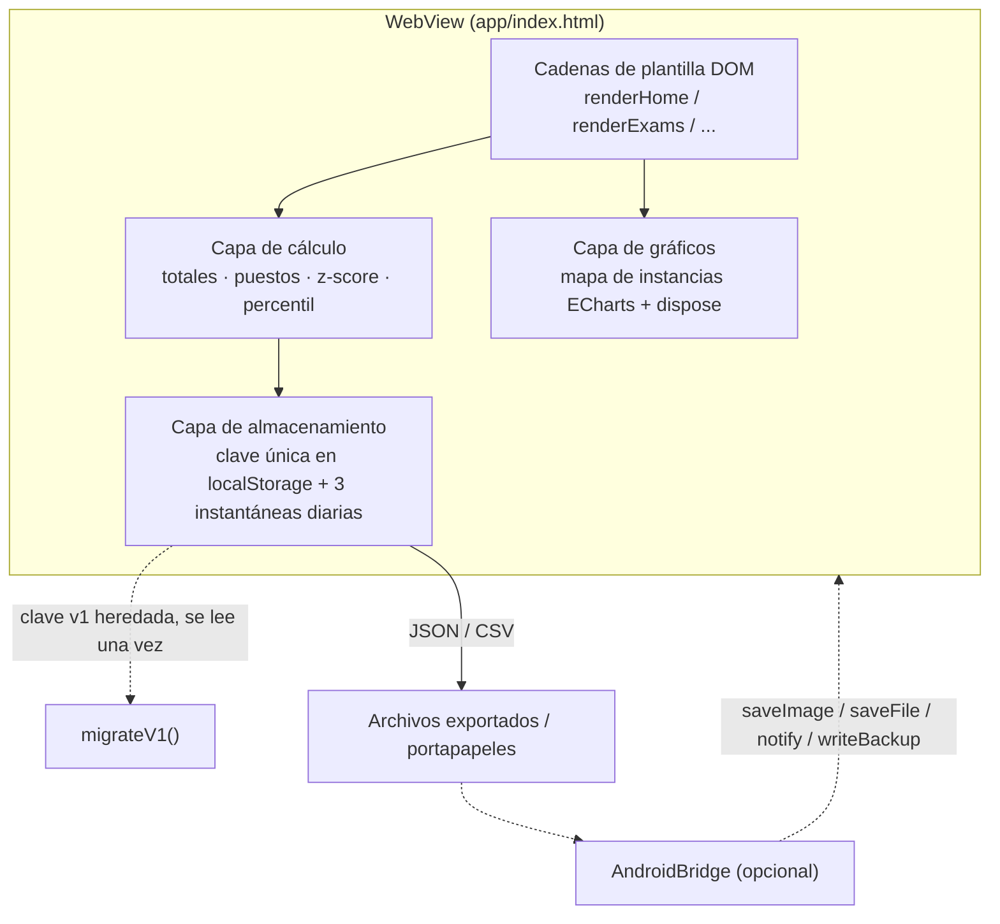

<div align="center">


# GradeTracker

**Gestor de calificaciones para Android totalmente offline — frontend WebView en un solo archivo + cadena de herramientas para reempaquetar APK con precisión quirúrgica**

Sin registro · Sin red · Sin telemetría · Tus datos solo viven en tu teléfono

<sub>[简体中文](README.md) · [English](README.en.md) · [日本語](README.ja.md) · [한국어](README.ko.md) · **Español** · [Русский](README.ru.md)</sub>

[](LICENSE)
[](https://github.com/axsdfg/GradeTracker/releases/latest)
[](https://github.com/axsdfg/GradeTracker/actions/workflows/ci.yml)
[](#requisitos-del-sistema)
[-059669.svg)](docs/PRIVACY.md)
[](test/)
[](app/index.html)

</div>

---

> **Idioma de la documentación** — Esta es la edición en español. La edición china es [README.md](README.md) y la inglesa [README.en.md](README.en.md). Las guías detalladas de [`docs/`](docs/) están actualmente solo en chino (se agradecen traducciones).
>
> Los conceptos propios del examen nacional chino (gaokao) se mantienen con el término original: 一分一段 (tabla de segmentos por puntuación) · 省控线 (línea de control provincial) · 赋分 (conversión de notas por niveles).

## Índice

- [Qué es](#qué-es)
- [Por qué resulta interesante](#por-qué-resulta-interesante)
- [Resumen de funciones](#resumen-de-funciones)
- [Estructura de la interfaz](#estructura-de-la-interfaz)
- [Inicio rápido](#inicio-rápido)
- [Datos, copias de seguridad y privacidad](#datos-copias-de-seguridad-y-privacidad)
- [Formatos de importación y exportación](#formatos-de-importación-y-exportación)
- [Estructura del proyecto](#estructura-del-proyecto)
- [Arquitectura](#arquitectura)
- [Empaquetado y firma del APK](#empaquetado-y-firma-del-apk)
- [Pruebas](#pruebas)
- [Limitaciones conocidas](#limitaciones-conocidas)
- [Hoja de ruta](#hoja-de-ruta)
- [Contribuir](#contribuir)
- [Licencia](#licencia)

---

## Qué es

**GradeTracker** es una herramienta para que los estudiantes de secundaria registren sus propias calificaciones. Toda la aplicación es un único archivo HTML (`app/index.html`, unas 3000 líneas) que se ejecuta dentro de un WebView de Android, con todos los datos escritos en `localStorage`.

El problema que resuelve es concreto: el boletín llega como una foto o como un mensaje en el grupo de la clase, y al final del trimestre es genuinamente difícil saber «¿esta asignatura está mejorando o empeorando?». La app permite registrar cada examen —nota por asignatura, puesto en la asignatura, puesto global— y luego responde a tres preguntas:

1. ¿Estoy **mejorando o quedándome atrás** entre exámenes? (curvas de tendencia con el eje de puestos invertido: más arriba es mejor)
2. ¿**Cuál es mi asignatura más floja**? (normalización entre asignaturas y un orden de prioridad para subir nota)
3. ¿**Cuánto me falta para mi objetivo**? (panel de objetivos que colorea la diferencia)

Además de la app, el repositorio incluye una **cadena de herramientas para reempaquetar APK que no necesita Android SDK ni Gradle**: se inserta el nuevo HTML en un APK ya firmado, se parchea el `AndroidManifest.xml` binario a nivel de byte, se rehace la alineación del ZIP y se vuelve a firmar con `apksig`. Está pensada para el caso «solo tengo un APK, no tengo el proyecto fuente».

## Por qué resulta interesante

Hay algunas decisiones de ingeniería poco habituales que pueden servirte si estás construyendo algo parecido:

| Decisión | Detalle |
|---|---|
| **Frontend en un solo archivo** | Sin paso de compilación, sin `node_modules`, sin framework. Editas una línea, guardas y recargas. El coste: la modularidad se sostiene por convención, no por `import` |
| **Cero permisos = privacidad a nivel de sistema** | El paquete original **no tiene el permiso `INTERNET`**. No es una promesa de «no subimos nada»: el sistema operativo lo hace imposible. Ningún código dentro del WebView (incluida una librería de gráficos sustituida) puede alcanzar la red |
| **La base de datos es localStorage** | Sin Room, sin SQLite. El coste está en las [limitaciones conocidas](#limitaciones-conocidas); la ventaja es que una copia de seguridad es solo un JSON |
| **Reempaquetado quirúrgico** | No se recompila nada. Solo se reemplaza `assets/index.html` y se parchea el manifiesto; las otras 395 entradas del ZIP quedan idénticas byte a byte al original |
| **La interfaz se ejecuta en Node** | La app completa corre bajo un stub de DOM en Node, con las 34 pruebas de regresión en verde: la lógica se verifica sin navegador |

## Resumen de funciones

Leyenda: ✅ implementado ｜ ⚠️ tiene alternativa ｜ ❌ requiere trabajo nativo; la interfaz del frontend ya existe

### Gestión de calificaciones

| Función | Estado | Detalle |
|---|---|---|
| Registro de exámenes | ✅ | Nombre, fecha, tipo (mensual, parcial, final, simulacro…), puesto global de clase y de curso, notas |
| Nota y puesto por asignatura | ✅ | 9 asignaturas configurables (3 troncales + 3 de 6 optativas), nota máxima por asignatura, puesto por asignatura en clase y curso |
| Visibilidad de asignaturas | ✅ | Las asignaturas no usadas se ocultan y quedan fuera de estadísticas y gráficos |
| Archivo por trimestre / curso | ✅ | Cada examen pertenece a un trimestre, conmutador en la cabecera; crear, renombrar y borrar trimestres vacíos |
| Migración automática | ✅ | Al abrir, los datos v1 (`grade_tracker_data`) pasan a la estructura v2; la clave antigua **se conserva, nunca se borra** |

### Análisis

| Función | Estado | Detalle |
|---|---|---|
| Tendencia de puestos / curva de progreso | ✅ | Línea del total o de una asignatura (con línea discontinua de nota máxima); dos líneas para puesto de clase y de curso, eje invertido |
| Fortaleza por asignatura | ✅ | Tasa de acierto como normalizador entre asignaturas; barras horizontales y orden de prioridad para subir nota |
| Radar de capacidades | ✅ | Este examen frente a la media personal: el desequilibrio se ve de un vistazo |
| Seguimiento de objetivos | ✅ | Objetivo frente a nota real por asignatura, diferencia con signo, barra de progreso, número de asignaturas cumplidas |
| Conversión nota → puesto | ✅ | Nota → puesto, alumnos con la misma nota, banda de puestos, percentil superado; comparación con líneas de control; conversión a escala de 750 |
| Vista para padres | ✅ | Oculta puestos y bandas, mostrando solo notas y tendencias |

### Registros y herramientas

| Función | Estado | Detalle |
|---|---|---|
| Cuaderno de errores | ✅ | Asignatura / examen vinculado / categoría de error / corrección / etiquetas / estado de dominio, con búsqueda y filtros (solo texto, sin imágenes) |
| Imagen del boletín | ✅ | Dibujada en un canvas de 1080×1500, se guarda con un toque (el puente nativo la guarda en la galería; si no, descarga del navegador) |
| Modos de puntuación | ✅ | Bruto / ponderado (Σ nota × peso) / convertido (tasa de acierto mapeada a un rango ajustable) |
| Cuenta atrás de exámenes | ✅ | Cuenta atrás en la pantalla de inicio y franjas de aviso a 3/7/14/30 días (las notificaciones del sistema necesitan el puente nativo; si no, aviso en la página) |
| Modo oscuro | ✅ | Seguir al sistema / claro / oscuro, con los colores de los gráficos sincronizados |
| Idioma de la interfaz | ✅ | 简体中文 / English / 日本語 / 한국어 / Español / Русский, seleccionable en Ajustes o siguiendo al sistema. Gráficos, tarjeta de notas y avisos también se traducen |
| Exportación de datos | ✅ | Copia completa en JSON y detalle de notas en CSV (con BOM, se abre directamente en Excel) |
| Importación de tablas | ✅ | Pegar desde Excel/WPS (TSV) o CSV; misma fecha y mismo nombre se fusionan en un solo examen |
| Copia automática | ✅ | Tres instantáneas diarias en el dispositivo (búfer circular), más cinco archivos si existe el puente nativo |
| Widget de pantalla de inicio | ❌ | Capacidad puramente nativa (Glance / AppWidget) |
| Foto de errores | ❌ | Requiere permiso de cámara y almacenamiento de imágenes; las imágenes desbordarían la cuota de localStorage |

## Estructura de la interfaz

Cinco pestañas inferiores, todas dentro del mismo HTML y conmutadas por `switchView()`:

| Pestaña | Contenido |
|---|---|
| **Inicio** | Total del trimestre actual, cambio desde el último examen, panel de objetivos, tendencia del total, cuenta atrás |
| **Exámenes** | Lista de exámenes (filtrada por trimestre) → detalle (nota, puesto y comparación de clase por asignatura) |
| **Análisis** | Tres subpestañas: tendencia / fortaleza / puestos |
| **Errores** | Tarjetas de errores, filtradas por asignatura y estado de dominio |
| **Ajustes** | Configuración de asignaturas, pesos y conversión, gestión de trimestres, fuente de datos, exportar/importar, tema, vista para padres |

## Inicio rápido

### Opción 1: descargar el APK

[**Descargar el APK más reciente**](https://github.com/axsdfg/GradeTracker/releases/latest) · 3,37 MiB · Android 7.0+ · seis idiomas de interfaz

La primera instalación requiere permitir «aplicaciones de origen desconocido». Este paquete está firmado con un **certificado de depuración**: sirve para instalarlo en tu propio teléfono, pero no se recomienda como distribución oficial. Para mantenerlo a largo plazo, compílalo tú mismo con una clave de publicación (opción 3).

> Lleva la misma firma que la versión anterior, así que instalarlo encima no borra las notas existentes. Las sumas de verificación están en la página de [Releases](https://github.com/axsdfg/GradeTracker/releases).

### Opción 2: compilar tu propio APK instalable

Necesitas un **APK existente** (como contenedor) y JDK 17:

```bash
# 1. Reemplazar el frontend y parchear el manifiesto; genera un paquete sin firmar
python tools/apk_repack.py original.apk app/index.html unsigned.apk

# 2. Volver a firmar (v1 + v2 + v3)
java tools/SignApk.java sign my.jks <storepass> <alias> unsigned.apk signed.apk 21

# 3. Verificar
java tools/SignApk.java verify signed.apk      # se espera verified = true, v1/v2/v3 en true
```

Los detalles, las trampas y los cambios en el manifiesto están en **[docs/PACKAGING.md](docs/PACKAGING.md)** (chino).

### Opción 3: integrarlo en tu propio proyecto Android

Coloca `app/index.html` en `app/src/main/assets/`, cárgalo con `WebViewAssetLoader` (más estable que `file://`) y conecta el puente JS:

```java
webView.addJavascriptInterface(new Bridge(this), "AndroidBridge");
webView.loadUrl("https://appassets.androidplatform.net/assets/index.html");
```

La implementación de referencia completa del contenedor nativo (14 KB: selección de archivos, descargas, guardado de imágenes, notificaciones y botón atrás) está en **[android/MainActivity.java](android/MainActivity.java)**; los cambios de manifiesto y permisos se documentan en **[docs/ANDROID-INTEGRATION.md](docs/ANDROID-INTEGRATION.md)** (chino).

### Opción 4: ejecutarlo en el navegador (desarrollo)

```bash
node scripts/fetch-vendor.js
node scripts/build-preview.js      # genera dist/preview.html (ECharts incrustado en un solo archivo)
# haz doble clic en dist/preview.html
```

También puedes abrir `app/index.html` directamente (requiere `app/echarts.min.js` al lado).

> El `localStorage` de los navegadores está separado por origen, así que `file://` y `http://localhost` no comparten datos. Tenlo en cuenta al depurar.

### Dependencia: ECharts

El repositorio **no incluye** `echarts.min.js` (1 MB de código minificado de terceros pertenece a una CDN). Ejecuta esto una vez antes del primer arranque:

```bash
node scripts/fetch-vendor.js        # descarga ECharts 5.6.0 en app/echarts.min.js
```

O descarga [echarts@5.6.0/dist/echarts.min.js](https://cdn.jsdelivr.net/npm/echarts@5.6.0/dist/echarts.min.js) manualmente y guárdalo como `app/echarts.min.js`.

> Solo se usan `line / bar / radar / tooltip`. Para reducir el tamaño, usa la compilación personalizada oficial de ECharts: ronda los 300 KB y el primer renderizado es aproximadamente el doble de rápido.

### Requisitos del sistema

- WebView 55+ (la página usa `async/await`), en la práctica **Android 7.0+**
- El `minSdk` del manifiesto es 21, pero en dispositivos anteriores a 7.0 la página se queda en blanco

## Datos, copias de seguridad y privacidad

| Elemento | Valor |
|---|---|
| Ubicación | `localStorage` del WebView (`/data/data/<paquete>/app_webview/Local Storage/`) |
| Clave principal | `grade_tracker_v2` |
| Clave heredada | `grade_tracker_data` (**no se borra** tras la migración) |
| Instantáneas diarias | `grade_tracker_bak_0/1/2`, búfer circular de 3 días |
| Copias en disco | Con `AndroidBridge.writeBackup`, 5 copias adicionales en `files/backups/` |
| Formato | JSON en texto plano |

**Comportamiento de red**: todo el frontend contiene exactamente **una** llamada a `fetch()` (`checkScoreDataUpdate`), y solo se dispara cuando has escrito una URL de fuente de datos en los ajustes y pulsas «Obtener ahora», o cuando la actualización automática está activa y han pasado más de 24 horas. Sin analítica, sin informes de fallos, sin SDK de terceros, sin ganchos de depuración remota del WebView.

**Sobre el permiso `INTERNET`**: el APK original no lo solicita, lo que convierte «los datos no pueden salir» en una garantía del sistema operativo. Añadirlo lo degrada a «el código se porta bien». El equilibrio se analiza en [docs/PRIVACY.md](docs/PRIVACY.md): la recomendación por defecto es mantener cero permisos y usar la vía de importación.

> ⚠️ **localStorage está en texto plano**. Con `android:allowBackup="false"` y `debuggable=false`, los métodos habituales no pueden leerlo, pero un dispositivo rooteado o alguien con acceso físico sí. No guardes aquí números de identidad ni nada parecido.

## Formatos de importación y exportación

### Importación de tablas de notas (TSV / CSV)

Copia un bloque de celdas directamente desde Excel/WPS y pégalo; las filas con la misma `date` (日期) y el mismo nombre de examen se fusionan en uno solo:

```csv
日期,考试名称,科目,分数,满分,班排,年排
2026-09-28,第一次月考,语文,112,150,8,45
2026-09-28,第一次月考,数学,134,150,5,31
```

> Los nombres de columna se comparan **en chino**. No los traduzcas. `满分` (nota máxima), `班排` (puesto en clase) y `年排` (puesto en curso) pueden omitirse.

### Datos de segmentos por puntuación (JSON)

```json
{
  "province": "浙江",
  "year": 2025,
  "subjectType": "普通类",
  "version": "2025.06",
  "controlLines": [
    { "name": "特殊类型招生控制线", "score": 592 },
    { "name": "一段线", "score": 495 }
  ],
  "segments": [
    { "score": 700, "count": 12, "cumulative": 120 },
    { "score": 699, "count": 25, "cumulative": 145 }
  ]
}
```

`segments` debe estar ordenado por puntuación **de mayor a menor**; si se omite `cumulative`, se acumula automáticamente.

> Los datos de ejemplo incluidos son **sintéticos**, y tanto la interfaz como los resultados se marcan con «datos de ejemplo · no aptos para solicitudes reales». Los datos reales deben exportarse de la autoridad examinadora provincial e importarse manualmente.

### Copias de seguridad

«Exportar copia» en los ajustes genera un JSON completo; «Importar copia» lo restaura en otro dispositivo. `<a download>` a menudo no hace nada dentro de un WebView, así que cuando no hay guardado nativo la app muestra un **cuadro de texto seleccionable**: al menos los datos se pueden sacar.

## Estructura del proyecto

```
GradeTracker/
├── app/
│   ├── index.html                 # la aplicación (un solo archivo, ~3000 líneas)
│   ├── README.md                  # notas del frontend
│   └── legacy/
│       └── index.v1.original.html # v1 original, para comparación y migración
├── android/
│   ├── MainActivity.java          # contenedor nativo de referencia
│   └── res/xml/                   # network_security_config, data_extraction_rules
├── tools/
│   ├── apk_repack.py              # reempaquetado: reemplazar assets + parchear AXML + alinear
│   ├── axml.py                    # analizador del AndroidManifest.xml binario
│   ├── SignApk.java               # firma y verificación apksig v1+v2+v3 (un archivo, JDK 17)
│   ├── dexinfo.py                 # inventario de clases/métodos DEX
│   └── disasm.py                  # desensamblador Dalvik mínimo
├── test/
│   ├── harness.js                 # stub de DOM + 34 pasos de regresión
│   └── migrate_test.js            # aserciones de migración v1 → v2 (18)
├── scripts/
│   ├── fetch-vendor.js            # descarga ECharts
│   └── build-preview.js           # genera la vista previa en un solo archivo
├── docs/
│   ├── ARCHITECTURE.md            # modelo de datos, canal de renderizado, ciclo de vida de gráficos
│   ├── FEATURES.md                # detalle de funciones y estrategia de alternativa
│   ├── PACKAGING.md               # reempaquetado y firma en profundidad
│   ├── ANDROID-INTEGRATION.md     # manifiesto, permisos, configuración de red, puente JS
│   ├── PRIVACY.md                 # flujo de datos y modelo de amenazas
│   ├── ROADMAP.md                 # dirección futura
│   ├── TRANSLATIONS.md            # estado de las traducciones y cómo añadir idiomas
│   └── apk-analysis-report.html   # análisis estático de un APK real (ejemplo)
├── assets/logo.svg
└── .github/workflows/ci.yml
```

## Arquitectura



Puntos clave del diseño:

- **Renderizado unidireccional**: `state` es la única fuente de verdad; `switchView()` → `renderXxx()` → construir una cadena HTML → `innerHTML`. Sin DOM virtual, y no hace falta.
- **Ciclo de vida de los gráficos**: las primeras versiones creaban un `new ResizeObserver` en cada `renderHome` sin desvincularlo, así que una docena de cambios de vista filtraba un lote. Hoy hay un mapa `charts` y un único listener global de `resize`, con `dispose` en cada cambio de vista.
- **Escribir nunca se interrumpe**: el buscador solo vuelve a dibujar el contenedor de la lista, no la página entera (lo que rompería la composición del IME chino).
- **Contención de XSS**: toda entrada del usuario y todo contenido importado pasa por `esc()` antes de llegar a una plantilla.
- **Mejora progresiva**: cada capacidad nativa está escrita como «si no hay puente, degradar», así que la app es totalmente usable en un navegador normal (salvo guardar en galería y notificaciones del sistema).

Detalles en **[docs/ARCHITECTURE.md](docs/ARCHITECTURE.md)** (chino).

## Empaquetado y firma del APK

`tools/apk_repack.py` evita Gradle y edita el paquete a nivel de byte del ZIP:

1. Reemplaza la entrada `assets/index.html` por la nueva;
2. Analiza el `AndroidManifest.xml` binario (pool de cadenas AXML + elementos + atributos), pone `debuggable` / `allowBackup` / `usesCleartextTraffic` en `false` y sube `versionCode` en 1;
3. Si se necesita red, añade `android.permission.INTERNET` al final del pool de cadenas e inserta un nodo `<uses-permission>` (los índices existentes no cambian);
4. Realinea a 4 bytes las entradas con `method=0` (stored), el equivalente a `zipalign`, dejando el resto idéntico byte a byte;
5. Elimina los archivos de firma v1 antiguos y entrega el paquete a `SignApk.java` para refirmar v1+v2+v3 con `apksig`.

Tres trampas frecuentes (todas resueltas en el código, ver [docs/PACKAGING.md](docs/PACKAGING.md)):

- El desplazamiento inicial de los atributos AXML es `pos + 16 + attributeStart`, no `pos + 24`;
- Algunos paquetes originales llevan un relleno de dos bytes ilegal en el campo `extra`, que debe descartarse;
- La alineación del ZIP debe calcularse con el **desplazamiento absoluto** `len(out) + 30 + nlen`, no con un desplazamiento interno de la entrada.

`SignApk.java` es un único archivo sin dependencias (solo necesita `apksig.jar` en el classpath) y se ejecuta en modo de archivo único de JDK 17:

```bash
java -cp apksig.jar tools/SignApk.java verify signed.apk
```

> `apksig.jar` (la librería oficial de firma de Google, unos 500 KB) y tu keystore **no** están en el repositorio: el primero se obtiene de Maven, el segundo es tu clave privada.

## Pruebas

La lógica se verifica sin navegador: `test/harness.js` ejecuta la app completa en Node bajo un stub de DOM mínimo.

```bash
node test/harness.js          # 34 pasos de regresión (render, import/export, tema, botón atrás...)
node test/harness.js --dump   # añade un resumen del estado y del render para revisión manual
node test/migrate_test.js     # migración v1 → v2, 18 aserciones
```

La CI (`.github/workflows/ci.yml`) ejecuta ambos comandos en cada push, más una comprobación de «garantía offline»: `app/index.html` no puede contener una dirección `http://` en texto plano ni un `<script src="http...">` externo.

**Sin cobertura**: el renderizado real, los gestos táctiles y el aspecto píxel a píxel de la imagen del boletín. Eso requiere un dispositivo o un navegador.

## Limitaciones conocidas

- **Un solo dispositivo**: los datos viven solo en el teléfono, sin sincronización ni copia en la nube. Cambiar de dispositivo implica exportar e importar JSON.
- **Capacidad de localStorage**: unos 5 MB, y es una API síncrona. Con muchos datos (decenas de miles de errores) habrá tirones.
- **Almacenamiento en texto plano**: ver la sección de privacidad.
- **La conversión de notas es un modelo simplificado**: un mapeo lineal de la tasa de acierto, no las reglas reales de conversión por niveles de cada provincia. Las reglas reales requieren tablas de segmentos provinciales.
- **Los datos de segmentos corren de tu cuenta**: las autoridades examinadoras no publican API abierta y los datos incluidos son sintéticos.
- **Falta la mitad de la integración con el sistema**: widget de inicio, foto de errores y notificaciones requieren trabajo nativo; en el frontend solo existen las interfaces.
- **Verificación limitada en dispositivo real**: el entorno de desarrollo original no tenía un motor de navegador usable, así que la lógica está garantizada por la suite de regresión; confirma lo visual y los gestos en un dispositivo real.

## Hoja de ruta

Ver [docs/ROADMAP.md](docs/ROADMAP.md). Los tres puntos más valiosos a corto plazo:

1. Sustituir la aproximación lineal por las reglas reales de conversión de cada provincia;
2. Dividir `index.html` en varios archivos bajo `src/` más un script de concatenación de 30 líneas (manteniendo la ventaja de «sin compilación» y recuperando la mantenibilidad);
3. Añadir una prueba de humo con Playwright que cubra la ruta de renderizado real.

## Contribuir

Se agradecen issues y PR, especialmente informes de compatibilidad en dispositivos reales, reglas provinciales de conversión de notas y adaptaciones a otros formatos de datos de segmentos. Lee primero [CONTRIBUTING.md](CONTRIBUTING.md) (chino).

Para añadir un idioma, consulta [docs/TRANSLATIONS.md](docs/TRANSLATIONS.md): los nuevos idiomas siguen el nombre `README.<código>.md` y deben añadirse al conmutador de idioma de todos los README.

## Licencia

[MIT](LICENSE) © 2026 axsdfg

ECharts lo publica la Apache Software Foundation bajo Apache-2.0 y no se distribuye con este repositorio.

---

<sub>[简体中文](README.md) · [English](README.en.md) · [日本語](README.ja.md) · [한국어](README.ko.md) · **Español** · [Русский](README.ru.md)</sub>
