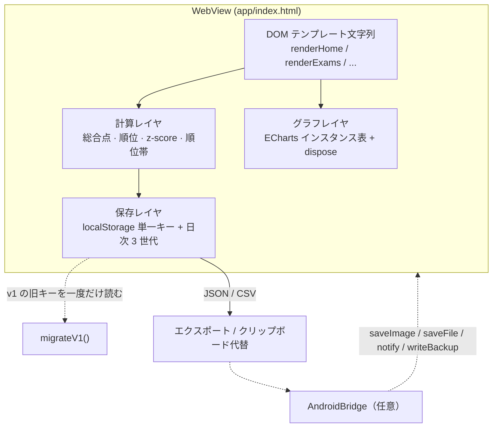

<div align="center">


# GradeTracker

**完全オフラインの Android 成績管理アプリ — 単一ファイルの WebView フロントエンド + 外科手術的な APK 再パッケージツールチェーン**

登録不要 · ネット接続なし · 計測なし · データはあなたの端末の中だけ

<sub>[简体中文](README.md) · [English](README.en.md) · **日本語** · [한국어](README.ko.md) · [Español](README.es.md) · [Русский](README.ru.md)</sub>

[](LICENSE)
[](https://github.com/axsdfg/GradeTracker/releases/latest)
[](https://github.com/axsdfg/GradeTracker/actions/workflows/ci.yml)
[](#システム要件)
[-059669.svg)](docs/PRIVACY.md)
[](test/)
[](app/index.html)

</div>

---

> **ドキュメントの言語** — これは日本語版です。中国語版は [README.md](README.md)、英語版は [README.en.md](README.en.md)。[`docs/`](docs/) 配下の詳細ドキュメントは現在中国語のみです（翻訳募集中）。
>
> 中国の高考（大学入学共通テスト）特有の用語は、原語を併記しています：一分一段（スコア分布表）・省控线（省の合格基準線）・赋分（等級換算）。

## 目次

- [これは何か](#これは何か)
- [なぜ見る価値があるか](#なぜ見る価値があるか)
- [機能一覧](#機能一覧)
- [画面構成](#画面構成)
- [クイックスタート](#クイックスタート)
- [データ・バックアップ・プライバシー](#データバックアッププライバシー)
- [インポートとエクスポートの形式](#インポートとエクスポートの形式)
- [プロジェクト構成](#プロジェクト構成)
- [アーキテクチャ](#アーキテクチャ)
- [APK のパッケージングと署名](#apk-のパッケージングと署名)
- [テスト](#テスト)
- [既知の制限](#既知の制限)
- [ロードマップ](#ロードマップ)
- [コントリビュート](#コントリビュート)
- [ライセンス](#ライセンス)

---

## これは何か

**GradeTracker** は、高校生が自分のために使う成績記録ツールです。アプリ本体は HTML ファイル 1 枚（`app/index.html`、約 3,000 行）だけで、Android の WebView 上で動作し、データはすべて `localStorage` に書き込まれます。

解決したい課題は具体的です。学校から配られる成績表は写真 1 枚かチャットの 1 メッセージで終わり、学期が終わる頃には「この科目は伸びているのか、落ちているのか」が分からなくなります。このアプリは各試験の科目別得点・科目順位・総合順位を記録し、次の 3 つの問いに答えます。

1. 直近の試験で**伸びているのか、落ちているのか**（推移グラフ。順位の軸は反転しており、上にあるほど良い）
2. **弱点はどの科目か**（得点率で科目をまたいで標準化し、得点アップの優先順位を提示）
3. **目標点まであと何点か**（達成パネルで差分を色分け表示）

アプリ本体に加えて、このリポジトリには **Android SDK も Gradle も使わない APK 再パッケージツールチェーン**も含まれます。署名済み APK に新しい HTML を差し込み、バイナリの `AndroidManifest.xml` をバイトレベルでパッチし、ZIP のアライメントをやり直し、`apksig` で再署名します。「手元に APK しかなく、ソースプロジェクトがない」場面のためのものです。

## なぜ見る価値があるか

やや珍しい設計判断がいくつかあり、似たものを作っている人には参考になるかもしれません。

| 判断 | 内容 |
|---|---|
| **単一ファイルのフロントエンド** | ビルド工程なし、`node_modules` なし、フレームワークなし。1 行直して保存し、再読み込みすれば反映される。代償は、モジュール化が `import` ではなく規約で成り立っていること |
| **権限ゼロ = OS レベルのプライバシー** | 元のパッケージは **`INTERNET` 権限を持ちません**。「アップロードしません」という約束ではなく、OS のレベルで送信できない構造です。WebView 内のどのコード（差し替えたチャートライブラリを含む）もネットワークに到達できません |
| **データベースは localStorage** | Room も SQLite もありません。代償は[既知の制限](#既知の制限)を参照。利点は、バックアップが単なる JSON になること |
| **外科手術的な再パッケージ** | プロジェクトを再ビルドせず、`assets/index.html` の差し替えとマニフェストのパッチだけを行う。残り 395 個の ZIP エントリは元のパッケージとバイト単位で同一 |
| **UI が Node 上で動く** | DOM スタブ上でアプリ全体を Node で実行し、34 ステップの回帰テストがすべて通る。ブラウザなしでロジックを検証できる |

## 機能一覧

凡例：✅ 実装済み ｜ ⚠️ 代替手段あり ｜ ❌ ネイティブ側の実装が必要（フロントエンドの口は用意済み）

### 成績管理

| 機能 | 状態 | 内容 |
|---|---|---|
| 試験の記録 | ✅ | 名称、日付、種別（月考／中間／期末／模試…）、総合のクラス順位・学年順位、メモ |
| 科目別の得点と順位 | ✅ | 9 科目を設定可能（国語・数学・英語 + 6 科目から 3 つ選択）。科目ごとの満点、科目別のクラス順位・学年順位 |
| 科目の表示/非表示 | ✅ | 使わない科目は非表示にでき、統計とグラフから除外される |
| 学期・学年のアーカイブ | ✅ | 試験は学期に属し、右上のカプセルで切り替え。学期の作成・改名・空学期の削除に対応 |
| 自動マイグレーション | ✅ | 起動時に v1 データ（`grade_tracker_data`）を v2 構造へ移行。旧キーは**そのまま残し、削除しない** |

### 分析

| 機能 | 状態 | 内容 |
|---|---|---|
| 順位の推移・進捗カーブ | ✅ | 総合または科目別の折れ線（満点の破線付き）。クラス順位と学年順位の 2 本、軸は反転 |
| 科目の強弱 | ✅ | 得点率による科目横断の標準化。横棒グラフと得点アップの優先順位 |
| 能力レーダー | ✅ | 今回と個人平均の比較。偏りの方向が一目で分かる |
| 目標達成 | ✅ | 科目ごとの目標点と今回の得点、± の差分、進捗バー、達成科目数 |
| スコア分布表・順位換算 | ✅ | 得点 → 順位、同点人数、順位帯、上位何 % か。省の合格基準線との比較。750 点満点への換算 |
| 保護者ビュー | ✅ | 順位と順位帯を隠し、得点と推移のみ表示 |

### 記録とツール

| 機能 | 状態 | 内容 |
|---|---|---|
| 間違いノート | ✅ | 科目／関連試験／誤答原因の分類／訂正／タグ／習得状態。検索と絞り込みに対応（テキストのみ、画像なし） |
| 成績表の共有画像 | ✅ | Canvas で 1080×1500 に描画し、ワンタップで保存（ネイティブブリッジがあればフォト蔵、なければブラウザのダウンロード） |
| 集計モード | ✅ | 素点／加重（Σ 得点 × 重み）／換算（得点率を任意の区間に写像） |
| 試験カウントダウン | ✅ | ホーム画面のカウントダウンと 3/7/14/30 日前のリマインダー（システム通知はネイティブブリッジが必要。未接続ならページ内表示） |
| ダークモード | ✅ | システムに追従／ライト／ダーク。グラフの配色も連動 |
| 表示言語 | ✅ | 簡体中文／English／日本語／한국어／Español／Русский。設定から切り替え、またはシステムに追従。グラフ・成績カード・トーストも連動 |
| データのエクスポート | ✅ | JSON の完全バックアップと CSV の得点明細（BOM 付き、Excel でそのまま開ける） |
| 表のインポート | ✅ | Excel/WPS からコピーして貼り付け（TSV）または CSV。日付と試験名が同じものは 1 回の試験に自動統合 |
| 自動バックアップ | ✅ | 1 日 3 世代のスナップショット（リングバッファ）。ネイティブブリッジがあればさらに 5 世代をファイルに保存 |
| ホーム画面ウィジェット | ❌ | 純粋にネイティブの機能（Glance / AppWidget） |
| 間違いの撮影 | ❌ | カメラ権限と画像保存が必要。画像を localStorage に入れると容量が破綻する |

## 画面構成

下部のタブは 5 つで、すべて同じ HTML 内にあり `switchView()` で切り替えます。

| タブ | 主な内容 |
|---|---|
| **ホーム** | 現在の学期の総合点、前回からの変化、目標達成パネル、総合点の推移、試験カウントダウン |
| **試験** | 試験一覧（学期で絞り込み）→ 詳細（科目別の得点・順位・クラス比較） |
| **分析** | 推移／強弱／順位の 3 つのサブタブ |
| **間違い** | 間違いカードの一覧。科目と習得状態で絞り込み |
| **設定** | 科目設定、重みと換算、学期管理、データソース、エクスポート/インポート、テーマ、保護者ビュー |

## クイックスタート

### 方法 1：APK をダウンロードする

[**最新版 APK をダウンロード**](https://github.com/axsdfg/GradeTracker/releases/latest) · 3.37 MiB · Android 7.0 以上 · UI は 6 言語対応

初回インストール時は「提供元不明のアプリ」を許可する必要があります。このパッケージは**デバッグ証明書**で署名されているため、自分で使う分には問題ありませんが、正式な配布物としては推奨しません。長期運用するなら正式な鍵で自分でビルドしてください（方法 3）。

> 旧版と同じ署名なので、上書きインストールしても既存の成績は消えません。チェックサムは [Releases](https://github.com/axsdfg/GradeTracker/releases) ページにあります。

### 方法 2：インストール可能な APK を自分でビルドする

**既存の APK**（殻として使う）と JDK 17 が必要です。

```bash
# 1. フロントエンドを差し替え、マニフェストをパッチして未署名パッケージを出力
python tools/apk_repack.py original.apk app/index.html unsigned.apk

# 2. 再署名（v1 + v2 + v3）
java tools/SignApk.java sign my.jks <storepass> <alias> unsigned.apk signed.apk 21

# 3. 検証
java tools/SignApk.java verify signed.apk      # verified = true、v1/v2/v3 がすべて true になるはず
```

詳細と落とし穴、マニフェストの変更点は **[docs/PACKAGING.md](docs/PACKAGING.md)**（中国語）にまとまっています。

### 方法 3：自分の Android プロジェクトに組み込む

`app/index.html` を `app/src/main/assets/` に置き、`WebViewAssetLoader` で読み込みます（`file://` より安定します）。そして JS ブリッジを接続します。

```java
webView.addJavascriptInterface(new Bridge(this), "AndroidBridge");
webView.loadUrl("https://appassets.androidplatform.net/assets/index.html");
```

ネイティブ側の完全なリファレンス実装（14 KB。ファイル選択、ダウンロード、画像保存、通知、戻るキーを含む）は **[android/MainActivity.java](android/MainActivity.java)**、マニフェストの変更と権限については **[docs/ANDROID-INTEGRATION.md](docs/ANDROID-INTEGRATION.md)**（中国語）を参照してください。

### 方法 4：ブラウザで直接動かす（開発・デバッグ）

```bash
node scripts/fetch-vendor.js
node scripts/build-preview.js      # dist/preview.html を生成（ECharts を単一ファイルにインライン化）
# dist/preview.html をダブルクリック
```

`app/index.html` を直接開くこともできます（同じディレクトリに `app/echarts.min.js` が必要）。

> ブラウザの `localStorage` はオリジン単位で分離されるため、`file://` と `http://localhost` のデータは共有されません。デバッグ時は注意してください。

### 依存関係：ECharts

リポジトリに `echarts.min.js` は**含まれていません**（1 MB のサードパーティ圧縮コードは CDN から取得する方が適切です）。初回起動の前に一度実行してください。

```bash
node scripts/fetch-vendor.js        # ECharts 5.6.0 を app/echarts.min.js に取得
```

または [echarts@5.6.0/dist/echarts.min.js](https://cdn.jsdelivr.net/npm/echarts@5.6.0/dist/echarts.min.js) を手動でダウンロードし、`app/echarts.min.js` として保存します。

> 使用しているのは `line / bar / radar / tooltip` のみです。より小さくしたい場合は ECharts 公式のオンラインカスタムビルドが使え、約 300 KB まで削減でき、初回描画もおよそ 2 倍速くなります。

### システム要件

- WebView 55 以上（`async/await` を使用）、実質 **Android 7.0 以上**
- マニフェストの `minSdk` は 21 ですが、7.0 未満の端末では画面が白くなる可能性があります

## データ・バックアップ・プライバシー

| 項目 | 値 |
|---|---|
| 保存場所 | WebView の `localStorage`（`/data/data/<パッケージ名>/app_webview/Local Storage/`） |
| 主キー | `grade_tracker_v2` |
| 旧版の互換キー | `grade_tracker_data`（移行後も**削除しない**） |
| 日次スナップショット | `grade_tracker_bak_0/1/2`、3 日分のリングバッファ |
| ネイティブ保存 | `AndroidBridge.writeBackup` があれば `files/backups/` に 5 世代追加保存 |
| 形式 | 平文 JSON |

**ネットワーク挙動**：フロントエンド全体で `fetch()` は**1 か所だけ**（`checkScoreDataUpdate`）です。しかも、設定画面でデータソースの URL を入力して「今すぐ取得」を押したとき、または自動更新が有効で 24 時間以上経過したときにしか動きません。計測も、クラッシュレポートも、サードパーティ SDK も、WebView のリモートデバッグフックもありません。

**`INTERNET` 権限について**：元の APK はこの権限を要求していないため、「データが出ていかない」は OS レベルでの保証です。これを追加すると「コードが自粛する」レベルの保証に下がります。このトレードオフは [docs/PRIVACY.md](docs/PRIVACY.md)で扱っています。既定では権限ゼロのまま、インポート方式を使うことを推奨します。

> ⚠️ **localStorage は平文です**。`android:allowBackup="false"` と `debuggable=false` を設定すれば通常の手段では読めませんが、root 化された端末や物理的にアクセスできる人には読めます。身分証番号のようなものは入れないでください。

## インポートとエクスポートの形式

### 成績表のインポート（TSV / CSV）

Excel/WPS から表をそのままコピーして貼り付けるだけです。`日期`（日付）と `考试名称`（試験名）が同じ行は 1 回の試験に統合されます。

```csv
日期,考试名称,科目,分数,满分,班排,年排
2026-09-28,第一次月考,语文,112,150,8,45
2026-09-28,第一次月考,数学,134,150,5,31
```

> 列名はアプリ側が**中国語で照合**します。翻訳せずそのまま使ってください。`满分`（満点）/ `班排`（クラス順位）/ `年排`（学年順位）は省略できます。

### スコア分布データ（JSON）

```json
{
  "province": "浙江",
  "year": 2025,
  "subjectType": "普通类",
  "version": "2025.06",
  "controlLines": [
    { "name": "特殊类型招生控制线", "score": 592 },
    { "name": "一段线", "score": 495 }
  ],
  "segments": [
    { "score": 700, "count": 12, "cumulative": 120 },
    { "score": 699, "count": 25, "cumulative": 145 }
  ]
}
```

`segments` は得点の**降順**で並べます。`cumulative` を省略すると自動で累積されます。

> アプリに同梱されているサンプルデータは**合成データ**です。画面にも結果にも「サンプルデータ · 実際の出願には使用不可」と明示されます。実データは各省の試験院からエクスポートし、自分でインポートしてください。

### バックアップ

設定画面の「バックアップを書き出す」で完全な JSON を生成し、「バックアップを読み込む」で別の端末に復元できます。WebView 内では `<a download>` が反応しないことが多いため、ネイティブの保存機能がない場合は**全選択してコピーできるテキスト欄**を表示します。少なくともデータは持ち出せます。

## プロジェクト構成

```
GradeTracker/
├── app/
│   ├── index.html                 # アプリ本体（単一ファイル、約 3,000 行）
│   ├── README.md                  # フロントエンドの説明
│   └── legacy/
│       └── index.v1.original.html # v1 の原本（比較と移行の参考用）
├── android/
│   ├── MainActivity.java          # ネイティブシェルのリファレンス実装
│   └── res/xml/                   # network_security_config、data_extraction_rules
├── tools/
│   ├── apk_repack.py              # 再パッケージ：assets 差し替え + AXML パッチ + アライメント
│   ├── axml.py                    # バイナリ AndroidManifest.xml パーサ
│   ├── SignApk.java               # apksig v1+v2+v3 の署名と検証（単一ファイル、JDK 17）
│   ├── dexinfo.py                 # DEX のクラス／メソッド一覧
│   └── disasm.py                  # 簡易 Dalvik 逆アセンブラ
├── test/
│   ├── harness.js                 # DOM スタブ + 34 ステップ回帰
│   └── migrate_test.js            # v1 → v2 移行のアサーション（18 項目）
├── scripts/
│   ├── fetch-vendor.js            # ECharts の取得
│   └── build-preview.js           # 単一ファイルのプレビュー生成
├── docs/
│   ├── ARCHITECTURE.md            # データモデル、描画パイプライン、グラフのライフサイクル
│   ├── FEATURES.md                # 機能の詳細と代替手段
│   ├── PACKAGING.md               # APK 再パッケージと署名の詳細
│   ├── ANDROID-INTEGRATION.md     # マニフェスト、権限、ネットワーク設定、JS ブリッジ
│   ├── PRIVACY.md                 # データフローと脅威モデル
│   ├── ROADMAP.md                 # 今後の方向性
│   ├── TRANSLATIONS.md            # 翻訳の状況と言語の追加方法
│   └── apk-analysis-report.html   # 実在する APK の静的解析レポート（例）
├── assets/logo.svg
└── .github/workflows/ci.yml
```

## アーキテクチャ



設計上の要点：

- **一方向レンダリング**：`state` が唯一の情報源で、`switchView()` → `renderXxx()` → HTML 文字列の組み立て → `innerHTML`。仮想 DOM は不要ですし、必要ありません。
- **グラフのライフサイクル**：初期版は `renderHome` のたびに `new ResizeObserver` を作り、解除もしていなかったため、十数回ビューを切り替えるとリークしました。現在は `charts` 表とグローバルの `resize` リスナに統一し、ビュー切り替え時に `dispose` します。
- **入力中は IME を妨げない**：検索ボックスはリストのコンテナだけを再描画し、ページ全体は再描画しません（中国語 IME の変換が途切れてしまうため）。
- **XSS の収束**：ユーザー入力とインポート内容はすべて `esc()` を通してからテンプレートに入れます。
- **プログレッシブエンハンスメント**：ネイティブ機能はすべて「ブリッジがなければ代替動作」として書かれているため、フォト蔵への保存とシステム通知を除き、素のブラウザでも完全に使えます。

詳細は **[docs/ARCHITECTURE.md](docs/ARCHITECTURE.md)**（中国語）を参照してください。

## APK のパッケージングと署名

`tools/apk_repack.py` は Gradle を使わず、ZIP のバイトレベルでパッケージを書き換えます。

1. `assets/index.html` のエントリを新しい内容に差し替える
2. バイナリの `AndroidManifest.xml`（AXML の文字列プール + 要素 + 属性）を解析し、`debuggable` / `allowBackup` / `usesCleartextTraffic` を `false` にし、`versionCode` を 1 増やす
3. ネットワークが必要な場合は、文字列プールの末尾に `android.permission.INTERNET` を追加し、`<uses-permission>` ノードを挿入する（既存の文字列インデックスは変わらない）
4. `method=0`（stored）のエントリを 4 バイト境界に再アライメントする（`zipalign` 相当）。その他のエントリはバイト単位でそのまま保持
5. 旧 v1 署名ファイルを除去し、`SignApk.java` で `apksig` の v1+v2+v3 再署名を行う

つまずきやすい 3 点（いずれもコード内で対処済み。詳しくは [docs/PACKAGING.md](docs/PACKAGING.md)）：

- AXML の属性開始オフセットは `pos + 16 + attributeStart` であり、`pos + 24` ではない
- 一部の元パッケージは `extra` フィールドに 2 バイトの不正なゼロ詰めがあり、これは捨てる必要がある
- ZIP のアライメントは**絶対オフセット** `len(out) + 30 + nlen` で計算する。エントリ内のオフセットではない

`SignApk.java` は単一ファイルで依存がなく（classpath に `apksig.jar` があれば動きます）、JDK 17 の単一ファイルソースモードで直接実行できます。

```bash
java -cp apksig.jar tools/SignApk.java verify signed.apk
```

> `apksig.jar`（Google 公式の署名ライブラリ、約 500 KB）とあなたの keystore は**リポジトリに含まれません**。前者は Maven から取得でき、後者はあなたの秘密鍵です。

## テスト

ブラウザがなくてもロジックを検証できます。`test/harness.js` は最小限の DOM スタブ上でアプリ全体を Node で動かします。

```bash
node test/harness.js          # 34 ステップの回帰（描画、入出力、テーマ、戻るキー…）
node test/harness.js --dump   # 状態と描画結果の要約も出力（目視確認用）
node test/migrate_test.js     # v1 → v2 移行、18 項目のアサーション
```

CI（`.github/workflows/ci.yml`）は push のたびに上記 2 コマンドに加え、「オフライン保証」チェックを実行します。`app/index.html` に平文の `http://` アドレスや外部の `<script src="http...">` が含まれてはいけません。

**カバーしていない範囲**：実際の描画、タッチ操作、Canvas 共有画像のピクセル単位の見た目。これらは実機かブラウザで確認する必要があります。

## 既知の制限

- **単一端末**：データは端末内のみで、同期もクラウドバックアップもありません。機種変更は JSON のエクスポート/インポートで行います。
- **localStorage の容量**：約 5 MB で、同期的な API です。データ量が多い（数万件の間違い）と引っかかりが出ます。
- **平文保存**：上記のプライバシーの節を参照してください。
- **換算は簡略モデル**：得点率の線形写像であり、各省の実際の等級換算規則ではありません。実際の規則には省ごとの区分表の実装が必要です。
- **スコア分布データは自分で用意**：試験院は公開 API を提供しておらず、同梱のデータは合成例です。
- **システム連携は半分**：ホーム画面ウィジェット、間違いの撮影、システム通知はいずれもネイティブ側の実装が必要で、フロントエンドには口だけがあります。
- **実機検証は限定的**：開発環境に利用可能なブラウザエンジンがなかったため、ロジックは回帰スクリプトで担保しています。見た目と操作は実機で確認してください。

## ロードマップ

[docs/ROADMAP.md](docs/ROADMAP.md) を参照してください。直近で価値が高いのは次の 3 点です。

1. 線形近似を各省の実際の等級換算規則に置き換える
2. `index.html` を `src/` 配下の複数ファイル + 30 行程度の連結スクリプトに分割する（「ビルドなし」の利点を保ったまま保守性を取り戻す）
3. 実際の描画経路をカバーする Playwright のスモークテストを追加する

## コントリビュート

Issue と PR を歓迎します。特に、実機での互換性報告、各省の等級換算規則、スコア分布データの形式への対応は助かります。まず [CONTRIBUTING.md](CONTRIBUTING.md)（中国語）をお読みください。

翻訳の追加については [docs/TRANSLATIONS.md](docs/TRANSLATIONS.md) を参照してください。新しい言語は `README.<言語コード>.md` という命名に従い、すべての README の言語切り替えに追記します。

## ライセンス

[MIT](LICENSE) © 2026 axsdfg

ECharts は Apache Software Foundation により Apache-2.0 で公開されており、このリポジトリには含まれません。

---

<sub>[简体中文](README.md) · [English](README.en.md) · **日本語** · [한국어](README.ko.md) · [Español](README.es.md) · [Русский](README.ru.md)</sub>
