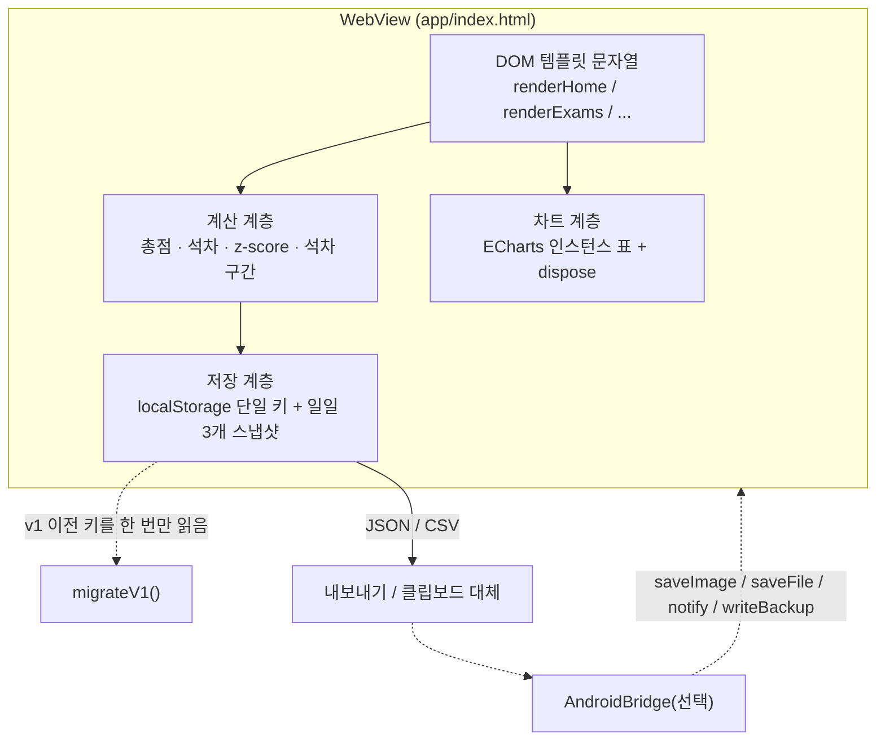

<div align="center">


# GradeTracker

**완전 오프라인 Android 성적 관리 앱 — 단일 파일 WebView 프런트엔드 + 외과수술식 APK 리패키징 툴체인**

가입 없음 · 네트워크 없음 · 추적 없음 · 데이터는 오직 내 휴대폰 안에

<sub>[简体中文](README.md) · [English](README.en.md) · [日本語](README.ja.md) · **한국어** · [Español](README.es.md) · [Русский](README.ru.md)</sub>

[](LICENSE)
[](https://github.com/axsdfg/GradeTracker/releases/latest)
[](https://github.com/axsdfg/GradeTracker/actions/workflows/ci.yml)
[](#시스템-요구-사항)
[-059669.svg)](docs/PRIVACY.md)
[](test/)
[](app/index.html)

</div>

---

> **문서 언어** — 이 문서는 한국어판입니다. 중국어판은 [README.md](README.md), 영어판은 [README.en.md](README.en.md)입니다. [`docs/`](docs/) 아래의 상세 문서는 현재 중국어로만 작성되어 있습니다(번역 기여 환영).
>
> 중국의 가오카오(대학 입학 공통시험) 특유의 용어는 원어를 함께 표기했습니다: 一分一段(점수 분포표) · 省控线(성의 합격 기준선) · 赋分(등급 환산).

## 목차

- [무엇인가](#무엇인가)
- [왜 볼 만한가](#왜-볼-만한가)
- [기능 개요](#기능-개요)
- [화면 구성](#화면-구성)
- [빠른 시작](#빠른-시작)
- [데이터, 백업, 프라이버시](#데이터-백업-프라이버시)
- [가져오기와 내보내기 형식](#가져오기와-내보내기-형식)
- [프로젝트 구조](#프로젝트-구조)
- [아키텍처](#아키텍처)
- [APK 패키징과 서명](#apk-패키징과-서명)
- [테스트](#테스트)
- [알려진 제약](#알려진-제약)
- [로드맵](#로드맵)
- [기여하기](#기여하기)
- [라이선스](#라이선스)

---

## 무엇인가

**GradeTracker**는 고등학생이 자신을 위해 쓰는 성적 기록 도구입니다. 앱 전체가 HTML 파일 하나(`app/index.html`, 약 3,000줄)로 이루어져 Android WebView에서 동작하며, 모든 데이터는 `localStorage`에 기록됩니다.

해결하려는 문제는 구체적입니다. 학교에서 나눠 주는 성적표는 사진 한 장이나 단체 채팅방 메시지 하나로 끝나고, 학기가 끝날 무렵에는 "이 과목이 오르고 있는지 내려가고 있는지"가 잘 보이지 않습니다. 이 앱은 시험마다 과목별 점수, 과목 석차, 종합 석차를 기록하고 다음 세 가지 질문에 답합니다.

1. 최근 시험에서 **오르고 있는지, 내려가고 있는지** (추이 그래프. 석차 축은 반전되어 위쪽일수록 좋음)
2. **어느 과목이 약점인지** (득점률로 과목 간 표준화하고, 점수 상승 우선순위를 제시)
3. **목표 점수까지 얼마나 남았는지** (목표 달성 패널에서 차이를 색으로 표시)

앱 자체 외에도 이 저장소에는 **Android SDK도 Gradle도 쓰지 않는 APK 리패키징 툴체인**이 포함되어 있습니다. 이미 서명된 APK에 새 HTML을 넣고, 바이너리 `AndroidManifest.xml`을 바이트 단위로 패치하고, ZIP 정렬을 다시 맞춘 뒤 `apksig`로 재서명합니다. "손에 APK만 있고 소스 프로젝트는 없는" 상황을 위한 도구입니다.

## 왜 볼 만한가

다소 드문 설계 선택이 몇 가지 있어, 비슷한 것을 만들고 있다면 참고가 될 수 있습니다.

| 선택 | 내용 |
|---|---|
| **단일 파일 프런트엔드** | 빌드 단계 없음, `node_modules` 없음, 프레임워크 없음. 한 줄 고치고 저장한 뒤 새로고침하면 반영됩니다. 대가는 모듈화가 `import`가 아니라 관례로 유지된다는 점 |
| **권한 0 = OS 수준 프라이버시** | 원본 패키지는 **`INTERNET` 권한이 없습니다**. "업로드하지 않겠다"는 약속이 아니라, 운영체제 수준에서 나갈 수 없는 구조입니다. WebView 안의 어떤 코드(교체된 차트 라이브러리 포함)도 네트워크에 접근할 수 없습니다 |
| **데이터베이스가 localStorage** | Room도 SQLite도 없습니다. 대가는 [알려진 제약](#알려진-제약)을 참고. 이점은 백업이 그냥 JSON 한 덩어리라는 것 |
| **외과수술식 리패키징** | 프로젝트를 다시 빌드하지 않고 `assets/index.html` 교체와 매니페스트 패치만 합니다. 나머지 395개 ZIP 항목은 원본과 바이트 단위로 동일 |
| **UI가 Node에서 돌아감** | DOM 스텁 위에서 앱 전체를 Node로 실행하며, 34단계 회귀 테스트가 모두 통과합니다. 브라우저 없이 로직을 검증할 수 있습니다 |

## 기능 개요

상태 표기: ✅ 구현됨 ｜ ⚠️ 대체 경로 있음 ｜ ❌ 네이티브 구현 필요(프런트엔드 인터페이스는 준비됨)

### 성적 관리

| 기능 | 상태 | 내용 |
|---|---|---|
| 시험 기록 | ✅ | 이름, 날짜, 유형(월례/중간/기말/모의…), 종합 반 석차·학년 석차, 메모 |
| 과목별 점수와 석차 | ✅ | 9개 과목 설정 가능(국어·수학·영어 + 6과목 중 3개 선택), 과목별 만점, 과목별 반 석차·학년 석차 |
| 과목 표시/숨김 | ✅ | 쓰지 않는 과목은 숨길 수 있고, 통계와 차트에서 제외됩니다 |
| 학기/학년 아카이빙 | ✅ | 시험은 학기에 속하며 우측 상단 캡슐로 전환. 학기 생성·이름 변경·빈 학기 삭제 지원 |
| 자동 마이그레이션 | ✅ | 실행 시 v1 데이터(`grade_tracker_data`)를 v2 구조로 이동. 이전 키는 **그대로 두고 삭제하지 않음** |

### 분석

| 기능 | 상태 | 내용 |
|---|---|---|
| 석차 추이 / 진척 곡선 | ✅ | 종합 또는 과목별 꺾은선(만점 점선 포함). 반 석차·학년 석차 두 개의 선, 축 반전 |
| 과목 강약 | ✅ | 득점률로 과목 간 표준화. 가로 막대와 점수 상승 우선순위 |
| 역량 레이더 | ✅ | 이번 시험과 개인 평균 비교. 편중 방향이 한눈에 보임 |
| 목표 달성 | ✅ | 과목별 목표 점수와 이번 성적, ± 차이, 진행 막대, 달성 과목 수 |
| 점수 분포표 / 석차 환산 | ✅ | 점수 → 석차, 동점 인원, 석차 구간, 상위 몇 %인지. 성 합격 기준선 비교. 750점 만점 환산 |
| 학부모 보기 | ✅ | 석차와 석차 구간을 숨기고 점수와 추이만 표시 |

### 기록과 도구

| 기능 | 상태 | 내용 |
|---|---|---|
| 오답 노트 | ✅ | 과목/연결 시험/오답 원인 분류/정정/태그/습득 상태. 검색과 필터 지원(텍스트만, 이미지 없음) |
| 성적표 공유 이미지 | ✅ | Canvas로 1080×1500에 그려 한 번에 저장(네이티브 브리지가 있으면 갤러리, 없으면 브라우저 다운로드) |
| 채점 모드 | ✅ | 원점수/가중(Σ 점수 × 가중치)/환산(득점률을 조정 가능한 구간에 매핑) |
| 시험 카운트다운 | ✅ | 홈 화면 카운트다운과 3/7/14/30일 알림 띠(시스템 알림은 네이티브 브리지 필요, 없으면 페이지 내 알림) |
| 다크 모드 | ✅ | 시스템 따름/라이트/다크, 차트 색상도 함께 전환 |
| 표시 언어 | ✅ | 简体中文/English/日本語/한국어/Español/Русский. 설정에서 전환하거나 시스템 설정을 따름. 차트·성적 카드·토스트도 함께 번역 |
| 데이터 내보내기 | ✅ | JSON 전체 백업과 CSV 성적 상세(BOM 포함, Excel에서 바로 열림) |
| 표 가져오기 | ✅ | Excel/WPS에서 복사해 붙여넣기(TSV) 또는 CSV. 날짜와 시험 이름이 같으면 한 번의 시험으로 자동 병합 |
| 자동 백업 | ✅ | 하루 3개 스냅샷(링 버퍼). 네이티브 브리지가 있으면 5개를 파일로 추가 저장 |
| 홈 화면 위젯 | ❌ | 순수 네이티브 기능(Glance / AppWidget) |
| 오답 촬영 | ❌ | 카메라 권한과 이미지 저장 필요. 이미지를 localStorage에 넣으면 용량이 터짐 |

## 화면 구성

하단 탭은 5개이며 모두 같은 HTML 안에 있고 `switchView()`로 전환합니다.

| 탭 | 주요 내용 |
|---|---|
| **홈** | 현재 학기 종합 점수, 지난번 대비 변화, 목표 달성 패널, 종합 점수 추이, 시험 카운트다운 |
| **시험** | 시험 목록(학기로 필터) → 상세(과목별 점수·석차·반 비교) |
| **분석** | 추이/강약/석차 세 개의 하위 탭 |
| **오답** | 오답 카드 목록. 과목과 습득 상태로 필터 |
| **설정** | 과목 설정, 가중치와 환산, 학기 관리, 데이터 소스, 내보내기/가져오기, 테마, 학부모 보기 |

## 빠른 시작

### 방법 1: APK 내려받기

[**GradeTracker_v2.0.0.apk 내려받기**](https://github.com/axsdfg/GradeTracker/releases/latest) · 3.35 MiB · Android 7.0 이상

처음 설치할 때 시스템에서 "출처를 알 수 없는 앱" 허용이 필요합니다. 이 패키지는 **디버그 인증서**로 서명되어 있어 직접 설치해 쓰기에는 적합하지만, 공식 배포본으로는 권장하지 않습니다. 장기적으로 관리하려면 정식 키로 직접 빌드하세요(방법 3).

> 이전 버전과 같은 서명이라 덮어 설치해도 기존 성적이 지워지지 않습니다. 체크섬은 [Releases](https://github.com/axsdfg/GradeTracker/releases) 페이지에 있습니다.

### 방법 2: 설치 가능한 APK를 직접 빌드

**이미 존재하는 APK**(껍데기로 사용)와 JDK 17이 필요합니다.

```bash
# 1. 프런트엔드 교체 및 매니페스트 패치, 서명되지 않은 패키지 출력
python tools/apk_repack.py original.apk app/index.html unsigned.apk

# 2. 재서명(v1 + v2 + v3)
java tools/SignApk.java sign my.jks <storepass> <alias> unsigned.apk signed.apk 21

# 3. 검증
java tools/SignApk.java verify signed.apk      # verified = true, v1/v2/v3 모두 true 여야 함
```

세부 사항과 함정, 매니페스트 변경은 **[docs/PACKAGING.md](docs/PACKAGING.md)**(중국어)에 정리되어 있습니다.

### 방법 3: 자신의 Android 프로젝트에 넣기

`app/index.html`을 `app/src/main/assets/`에 두고 `WebViewAssetLoader`로 불러옵니다(`file://`보다 안정적). 그다음 JS 브리지를 연결합니다.

```java
webView.addJavascriptInterface(new Bridge(this), "AndroidBridge");
webView.loadUrl("https://appassets.androidplatform.net/assets/index.html");
```

네이티브 셸의 완전한 참조 구현(14 KB, 파일 선택·다운로드·이미지 저장·알림·뒤로 가기 포함)은 **[android/MainActivity.java](android/MainActivity.java)**, 매니페스트 변경과 권한 설명은 **[docs/ANDROID-INTEGRATION.md](docs/ANDROID-INTEGRATION.md)**(중국어)를 참고하세요.

### 방법 4: 브라우저에서 바로 실행(개발·디버깅)

```bash
node scripts/fetch-vendor.js
node scripts/build-preview.js      # dist/preview.html 생성(ECharts를 단일 파일로 인라인)
# dist/preview.html 을 더블클릭
```

`app/index.html`을 직접 열어도 됩니다(같은 디렉터리에 `app/echarts.min.js` 필요).

> 브라우저의 `localStorage`는 오리진 단위로 분리되므로 `file://`과 `http://localhost`의 데이터는 공유되지 않습니다. 디버깅할 때 주의하세요.

### 의존성: ECharts

저장소에 `echarts.min.js`는 **포함되어 있지 않습니다**(1 MB의 서드파티 압축 코드는 CDN에서 받는 편이 적절합니다). 첫 실행 전에 한 번 실행하세요.

```bash
node scripts/fetch-vendor.js        # ECharts 5.6.0 을 app/echarts.min.js 로 다운로드
```

또는 [echarts@5.6.0/dist/echarts.min.js](https://cdn.jsdelivr.net/npm/echarts@5.6.0/dist/echarts.min.js)를 직접 내려받아 `app/echarts.min.js`로 저장합니다.

> 사용하는 것은 `line / bar / radar / tooltip`뿐입니다. 더 작게 만들려면 ECharts 공식 온라인 커스텀 빌드를 쓰면 약 300 KB까지 줄일 수 있고, 첫 렌더링도 대략 두 배 빨라집니다.

### 시스템 요구 사항

- WebView 55 이상(`async/await` 사용), 실제로는 **Android 7.0 이상**
- 매니페스트의 `minSdk`는 21이지만 7.0 미만 기기에서는 화면이 하얗게 나올 수 있습니다

## 데이터, 백업, 프라이버시

| 항목 | 값 |
|---|---|
| 저장 위치 | WebView `localStorage`(`/data/data/<패키지명>/app_webview/Local Storage/`) |
| 기본 키 | `grade_tracker_v2` |
| 이전 버전 호환 키 | `grade_tracker_data`(마이그레이션 후에도 **삭제하지 않음**) |
| 일일 스냅샷 | `grade_tracker_bak_0/1/2`, 3일 링 버퍼 |
| 네이티브 저장 | `AndroidBridge.writeBackup`이 있으면 `files/backups/`에 5개 추가 |
| 형식 | 평문 JSON |

**네트워크 동작**: 프런트엔드 전체에서 `fetch()`는 **한 곳뿐**(`checkScoreDataUpdate`)입니다. 그것도 설정 화면에서 데이터 소스 주소를 입력하고 "지금 가져오기"를 눌렀을 때, 또는 자동 업데이트가 켜져 있고 24시간 이상 지났을 때만 동작합니다. 추적도, 크래시 리포트도, 서드파티 SDK도, WebView 원격 디버깅 훅도 없습니다.

**`INTERNET` 권한에 대하여**: 원본 APK는 이 권한을 요청하지 않으므로 "데이터가 나갈 수 없다"는 OS 수준의 보장입니다. 이 권한을 추가하면 "코드가 스스로 자제한다" 수준으로 낮아집니다. 이 트레이드오프는 [docs/PRIVACY.md](docs/PRIVACY.md)에서 다룹니다. 기본 권장은 권한 0을 유지하고 가져오기 방식을 쓰는 것입니다.

> ⚠️ **localStorage는 평문입니다**. `android:allowBackup="false"`와 `debuggable=false`를 설정하면 일반적인 방법으로는 읽을 수 없지만, 루팅된 기기나 물리적 접근 권한이 있는 사람은 읽을 수 있습니다. 신분증 번호 같은 것은 넣지 마세요.

## 가져오기와 내보내기 형식

### 성적 표 가져오기(TSV / CSV)

Excel/WPS에서 표를 그대로 복사해 붙여넣으면 됩니다. `日期`(날짜)와 `考试名称`(시험 이름)이 같은 행은 자동으로 한 번의 시험으로 병합됩니다.

```csv
日期,考试名称,科目,分数,满分,班排,年排
2026-09-28,第一次月考,语文,112,150,8,45
2026-09-28,第一次月考,数学,134,150,5,31
```

> 열 이름은 앱이 **중국어로 매칭**합니다. 번역하지 말고 그대로 쓰세요. `满分`(만점)/`班排`(반 석차)/`年排`(학년 석차)는 생략할 수 있습니다.

### 점수 분포 데이터(JSON)

```json
{
  "province": "浙江",
  "year": 2025,
  "subjectType": "普通类",
  "version": "2025.06",
  "controlLines": [
    { "name": "特殊类型招生控制线", "score": 592 },
    { "name": "一段线", "score": 495 }
  ],
  "segments": [
    { "score": 700, "count": 12, "cumulative": 120 },
    { "score": 699, "count": 25, "cumulative": 145 }
  ]
}
```

`segments`는 점수 **내림차순**으로 정렬합니다. `cumulative`를 생략하면 자동으로 누적됩니다.

> 앱에 포함된 예시 데이터는 **합성 데이터**이며, 화면과 결과 모두 "예시 데이터 · 실제 지원에 사용 불가"로 표시됩니다. 실제 데이터는 성 시험원에서 내보낸 뒤 직접 가져오세요.

### 백업

설정 화면의 "백업 내보내기"는 완전한 JSON을 만들고, "백업 가져오기"는 다른 기기에서 복원합니다. WebView에서는 `<a download>`가 반응하지 않는 경우가 많아, 네이티브 저장 기능이 없으면 **전체 선택해 복사할 수 있는 텍스트 상자**를 띄웁니다. 최소한 데이터는 꺼낼 수 있습니다.

## 프로젝트 구조

```
GradeTracker/
├── app/
│   ├── index.html                 # 앱 본체(단일 파일, 약 3,000줄)
│   ├── README.md                  # 프런트엔드 설명
│   └── legacy/
│       └── index.v1.original.html # v1 원본(비교와 마이그레이션 참고용)
├── android/
│   ├── MainActivity.java          # 네이티브 셸 참조 구현
│   └── res/xml/                   # network_security_config, data_extraction_rules
├── tools/
│   ├── apk_repack.py              # 리패키징: assets 교체 + AXML 패치 + 정렬
│   ├── axml.py                    # 바이너리 AndroidManifest.xml 파서
│   ├── SignApk.java               # apksig v1+v2+v3 서명과 검증(단일 파일, JDK 17)
│   ├── dexinfo.py                 # DEX 클래스/메서드 목록
│   └── disasm.py                  # 간단한 Dalvik 디스어셈블러
├── test/
│   ├── harness.js                 # DOM 스텁 + 34단계 회귀
│   └── migrate_test.js            # v1 → v2 마이그레이션 단언(18개)
├── scripts/
│   ├── fetch-vendor.js            # ECharts 다운로드
│   └── build-preview.js           # 단일 파일 미리보기 생성
├── docs/
│   ├── ARCHITECTURE.md            # 데이터 모델, 렌더 파이프라인, 차트 생명주기
│   ├── FEATURES.md                # 기능 상세와 대체 경로
│   ├── PACKAGING.md               # APK 리패키징과 서명 상세
│   ├── ANDROID-INTEGRATION.md     # 매니페스트, 권한, 네트워크 설정, JS 브리지
│   ├── PRIVACY.md                 # 데이터 흐름과 위협 모델
│   ├── ROADMAP.md                 # 향후 방향
│   ├── TRANSLATIONS.md            # 번역 현황과 언어 추가 방법
│   └── apk-analysis-report.html   # 실제 APK 하나의 정적 분석 보고서(예시)
├── assets/logo.svg
└── .github/workflows/ci.yml
```

## 아키텍처



핵심 설계:

- **단방향 렌더링**: `state`가 유일한 정보원이며 `switchView()` → `renderXxx()` → HTML 문자열 조립 → `innerHTML`. 가상 DOM은 없고, 필요하지도 않습니다.
- **차트 생명주기**: 초기 버전은 `renderHome`마다 `new ResizeObserver`를 만들고 해제하지 않아, 열 번 넘게 화면을 전환하면 누수가 쌓였습니다. 지금은 `charts` 표와 전역 `resize` 리스너로 통일하고, 화면 전환 시 `dispose`합니다.
- **입력 중 IME 방해 없음**: 검색 상자는 목록 컨테이너만 다시 그리고 페이지 전체는 다시 그리지 않습니다(중국어 IME 조합이 끊기기 때문).
- **XSS 차단**: 사용자 입력과 가져온 내용은 모두 `esc()`를 거쳐 템플릿에 들어갑니다.
- **점진적 향상**: 모든 네이티브 기능은 "브리지가 없으면 대체 동작"으로 작성되어, 갤러리 저장과 시스템 알림을 제외하면 순수 브라우저에서도 완전히 사용할 수 있습니다.

세부 사항은 **[docs/ARCHITECTURE.md](docs/ARCHITECTURE.md)**(중국어)를 참고하세요.

## APK 패키징과 서명

`tools/apk_repack.py`는 Gradle을 쓰지 않고 ZIP 바이트 수준에서 패키지를 수정합니다.

1. `assets/index.html` 항목을 새 내용으로 교체
2. 바이너리 `AndroidManifest.xml`(AXML 문자열 풀 + 요소 + 속성)을 파싱해 `debuggable` / `allowBackup` / `usesCleartextTraffic`을 `false`로, `versionCode`를 1 증가
3. 네트워크가 필요하면 문자열 풀 끝에 `android.permission.INTERNET`을 추가하고 `<uses-permission>` 노드를 삽입(기존 문자열 인덱스는 그대로)
4. `method=0`(stored) 항목을 4바이트 경계로 다시 정렬(`zipalign` 상당). 나머지 항목은 바이트 단위로 그대로 유지
5. 이전 v1 서명 파일을 제거하고 `SignApk.java`가 `apksig`로 v1+v2+v3 재서명

자주 걸리는 세 가지(모두 코드에서 처리됨, 자세한 내용은 [docs/PACKAGING.md](docs/PACKAGING.md)):

- AXML 속성 시작 오프셋은 `pos + 16 + attributeStart`이며 `pos + 24`가 아닙니다
- 일부 원본 패키지는 `extra` 필드에 2바이트의 잘못된 0 채움이 있어 이를 버려야 합니다
- ZIP 정렬은 **절대 오프셋** `len(out) + 30 + nlen`으로 계산하며, 항목 내부 오프셋이 아닙니다

`SignApk.java`는 단일 파일이고 의존성이 없으며(classpath에 `apksig.jar`만 있으면 됨), JDK 17 단일 파일 소스 모드로 바로 실행할 수 있습니다.

```bash
java -cp apksig.jar tools/SignApk.java verify signed.apk
```

> `apksig.jar`(Google 공식 서명 라이브러리, 약 500 KB)와 당신의 keystore는 **저장소에 포함되지 않습니다**. 전자는 Maven에서 받을 수 있고, 후자는 당신의 개인 키입니다.

## 테스트

브라우저 없이도 로직을 검증할 수 있습니다. `test/harness.js`는 최소한의 DOM 스텁 위에서 앱 전체를 Node로 실행합니다.

```bash
node test/harness.js          # 34단계 회귀(렌더링, 가져오기/내보내기, 테마, 뒤로 가기…)
node test/harness.js --dump   # 상태와 렌더 결과 요약도 출력(육안 확인용)
node test/migrate_test.js     # v1 → v2 마이그레이션, 18개 단언
```

CI(`.github/workflows/ci.yml`)는 push마다 위 두 명령과 함께 "오프라인 보장" 검사를 실행합니다. `app/index.html`에 평문 `http://` 주소나 외부 `<script src="http...">`가 있어서는 안 됩니다.

**다루지 않는 범위**: 실제 렌더링, 터치 제스처, Canvas 공유 이미지의 픽셀 단위 모양. 이는 실기기나 브라우저에서 확인해야 합니다.

## 알려진 제약

- **단일 기기**: 데이터는 기기 안에만 있고 동기화도 클라우드 백업도 없습니다. 기기 변경은 JSON 내보내기/가져오기로 합니다.
- **localStorage 용량**: 약 5 MB이며 동기 API입니다. 데이터가 많으면(수만 건의 오답) 끊김이 생깁니다.
- **평문 저장**: 위의 프라이버시 절을 참고하세요.
- **환산은 단순화 모델**: 득점률의 선형 매핑이며, 각 성의 실제 등급 환산 규칙이 아닙니다. 실제 규칙은 성별 구간표 구현이 필요합니다.
- **점수 분포 데이터는 직접 구해야 함**: 시험원은 공개 API를 제공하지 않으며, 포함된 데이터는 합성 예시입니다.
- **시스템 통합은 절반**: 홈 화면 위젯, 오답 촬영, 시스템 알림은 모두 네이티브 구현이 필요하고 프런트엔드에는 인터페이스만 있습니다.
- **실기기 검증 제한**: 개발 환경에 쓸 만한 브라우저 엔진이 없어 로직은 회귀 스크립트로 보증합니다. 시각과 제스처는 실기기에서 확인하세요.

## 로드맵

[docs/ROADMAP.md](docs/ROADMAP.md)를 참고하세요. 가까운 시기에 가치가 큰 세 가지:

1. 선형 근사를 각 성의 실제 등급 환산 규칙으로 교체
2. `index.html`을 `src/` 아래 여러 파일 + 30줄짜리 연결 스크립트로 분리("빌드 없음"의 장점을 유지하면서 유지보수성 회복)
3. 실제 렌더링 경로를 다루는 Playwright 스모크 테스트 추가

## 기여하기

이슈와 PR을 환영합니다. 특히 실기기 호환성 보고, 각 성의 등급 환산 규칙, 점수 분포 데이터 형식 대응이 도움이 됩니다. 먼저 [CONTRIBUTING.md](CONTRIBUTING.md)(중국어)를 읽어 주세요.

번역 추가는 [docs/TRANSLATIONS.md](docs/TRANSLATIONS.md)를 참고하세요. 새 언어는 `README.<언어코드>.md` 명명을 따르고, 모든 README의 언어 전환 줄에 추가합니다.

## 라이선스

[MIT](LICENSE) © 2026 axsdfg

ECharts는 Apache Software Foundation이 Apache-2.0으로 배포하며, 이 저장소에 포함되지 않습니다.

---

<sub>[简体中文](README.md) · [English](README.en.md) · [日本語](README.ja.md) · **한국어** · [Español](README.es.md) · [Русский](README.ru.md)</sub>
