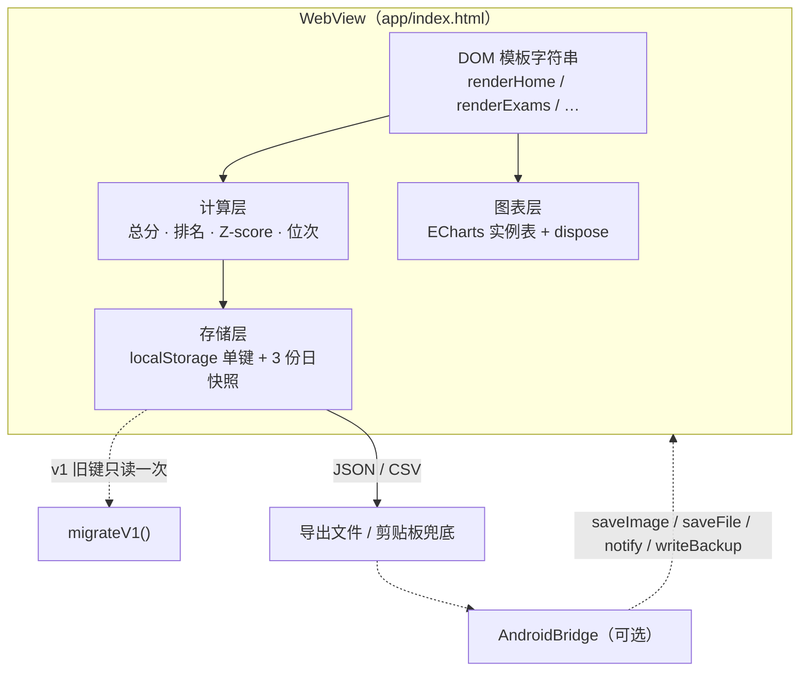

<div align="center">


# 成绩追踪 · GradeTracker

**一个完全离线的 Android 成绩管理应用 —— 单文件 WebView 前端 + 外科手术式 APK 重打包工具链**

不用注册 · 不联网 · 无埋点 · 数据只存在你自己的手机里

[](LICENSE)
[](#系统要求)
[-059669.svg)](docs/PRIVACY.md)
[](test/)
[](app/index.html)

</div>

---

## 目录

- [这是什么](#这是什么)
- [为什么值得一看](#为什么值得一看)
- [功能总览](#功能总览)
- [界面结构](#界面结构)
- [快速开始](#快速开始)
- [数据、备份与隐私](#数据备份与隐私)
- [导入与导出格式](#导入与导出格式)
- [项目结构](#项目结构)
- [架构说明](#架构说明)
- [APK 打包与签名工具链](#apk-打包与签名工具链)
- [测试](#测试)
- [已知限制](#已知限制)
- [路线图](#路线图)
- [参与贡献](#参与贡献)
- [许可证](#许可证)
- [English](#english)

---

## 这是什么

**GradeTracker（成绩追踪）** 是给中学生自己用的成绩记录工具。它的全部代码就是一个 HTML 文件（`app/index.html`，约 3000 行），跑在 Android 的 WebView 里，所有数据写在 `localStorage` 里。

它解决的问题很具体：学校发的成绩单是一张图、一次考试一个群消息，一个学期下来想看清"我这科到底在进步还是退步"很难。这个应用让你把每次考试的各科分数、单科排名、总分排名记下来，然后回答三个问题：

1. 我这几次考试在**进步还是退步**？（趋势曲线，名次纵轴反向——越靠上越好）
2. 我的**短板是哪一科**？（跨科标准化后的强弱排序 + 提分优先级）
3. 我离**目标分**还差多少？（目标达成面板，差值直接用颜色标出来）

除了应用本身，这个仓库还包含一套**不依赖 Android SDK / Gradle 的 APK 重打包工具链**：把新的 HTML 塞进一个已签名的 APK 里，字节级补丁二进制 `AndroidManifest.xml`，重做 ZIP 对齐，再用 `apksig` 重新签名。适合"我手上只有一个 APK，没有源码工程"的场景。

## 为什么值得一看

这个项目有几个不太常见的工程取舍，如果你在做类似的东西，可能会感兴趣：

| 取舍 | 说明 |
|---|---|
| **单文件前端** | 没有构建步骤、没有 `node_modules`、没有框架。改一行保存，刷新就生效。代价是模块化靠约定而非 `import` |
| **零权限 = 物理级隐私** | 原包**没有 `INTERNET` 权限**。这不是"承诺不上传"，而是操作系统层面发不出去——WebView 里任何代码（包括被替换掉的图表库）都拿不到网络 |
| **数据库就是 localStorage** | 没有 Room、没有 SQLite。代价见[已知限制](#已知限制)，好处是备份就是一段 JSON |
| **外科手术式重打包** | 不重新构建工程，只替换 `assets/index.html` + 补丁清单，其余 395 个 ZIP 条目与原包逐字节一致 |
| **能在 Node 里跑 UI** | 用 DOM 桩把整个应用跑在 Node 里，34 步回归全部通过——没有浏览器也能验证逻辑 |

## 功能总览

状态说明：✅ 已实现 ｜ ⚠️ 有降级方案 ｜ ❌ 需要原生侧配合，前端已留接口

### 成绩管理

| 功能 | 状态 | 说明 |
|---|---|---|
| 考试记录 | ✅ | 名称、日期、类型（月考/期中/期末/模拟…）、总分班排/年排、备注 |
| 单科分数与排名 | ✅ | 9 科可配（语数英 + 6 选 3），每科独立满分、单科班排/年排 |
| 科目显隐 | ✅ | 不选的科目可以隐藏，不参与统计与图表 |
| 学期 / 学年归档 | ✅ | 考试归属学期，右上角胶囊切换；支持新建、改名、删除空学期 |
| 自动迁移 | ✅ | 打开即把 v1 数据（`grade_tracker_data`）搬到 v2 结构，旧键**原样保留不删** |

### 分析

| 功能 | 状态 | 说明 |
|---|---|---|
| 排名趋势 / 进步曲线 | ✅ | 总分或单科折线（含满分虚线）；班排/年排双折线，纵轴反向 |
| 单科强弱 | ✅ | 用得分率做跨科标准化，横向条形图 + 提分优先级排序 |
| 能力雷达 | ✅ | 本次 vs 个人均值，一眼看出偏科方向 |
| 目标达成 | ✅ | 每科目标分 vs 本次成绩、差值 ±、进度条、达标科数统计 |
| 一分一段 / 位次换算 | ✅ | 分数 → 位次、同分人数、位次区间、超越百分比；省控线对比；750 分制折算 |
| 家长视图 | ✅ | 隐藏排名与位次，只显示分数和趋势 |

### 记录与工具

| 功能 | 状态 | 说明 |
|---|---|---|
| 错题本 | ✅ | 科目 / 关联考试 / 错因分类 / 订正 / 标签 / 掌握状态，可搜索筛选（文本版，不含图片） |
| 成绩单分享图 | ✅ | Canvas 1080×1500 绘制，点一下保存（有原生桥则存相册，否则浏览器下载） |
| 计分模式 | ✅ | 原始 / 加权（Σ分数×权重）/ 赋分（得分率映射到可调区间） |
| 考试倒计时 | ✅ | 首页倒计时 + 3/7/14/30 天提醒条（系统通知需原生桥，未接则页内提醒） |
| 深色模式 | ✅ | 跟随系统 / 浅色 / 深色，图表配色同步切换 |
| 数据导出 | ✅ | JSON 全量备份 + CSV 成绩明细（带 BOM，Excel 直接打开） |
| 表格导入 | ✅ | 从 Excel/WPS 复制粘贴（TSV）或 CSV，同日同名自动合并成一场考试 |
| 自动备份 | ✅ | 每天本机保留 3 份快照（环形覆盖），有原生桥时额外落盘 5 份 |
| 桌面小组件 | ❌ | 纯原生能力（Glance/AppWidget） |
| 错题拍照 | ❌ | 需要相机权限 + 图片存储；图片塞 localStorage 会爆容量 |

## 界面结构

底部 5 个标签，全部在同一个 HTML 里通过 `switchView()` 切换：

| 标签 | 关键内容 |
|---|---|
| **首页** | 当前学期总分、较上次变化、目标达成面板、总分趋势图、考试倒计时 |
| **考试** | 考试列表（按学期过滤）→ 详情（各科分数/排名/班级对比） |
| **分析** | 三个子标签：趋势 / 强弱 / 位次 |
| **错题** | 错题卡片列表，按科目、掌握状态筛选 |
| **设置** | 科目配置、权重与赋分、学期管理、数据源、导出导入、主题、家长视图 |

## 快速开始

### 前置：ECharts

仓库**不包含** `echarts.min.js`（1 MB 的第三方压缩代码，通过 CDN 获取更合适）。首次运行前执行一次：

```bash
node scripts/fetch-vendor.js        # 下载 ECharts 5.6.0 到 app/echarts.min.js
```

或者手动下载 [echarts@5.6.0/dist/echarts.min.js](https://cdn.jsdelivr.net/npm/echarts@5.6.0/dist/echarts.min.js)，保存为 `app/echarts.min.js`。

> 只用到了 `line / bar / radar / tooltip`。要更小的体积，可用 ECharts 官方在线定制构建，能压到约 300 KB，启动渲染大约快一倍。

### 方式一：直接在浏览器里跑（最快）

```bash
node scripts/fetch-vendor.js
node scripts/build-preview.js      # 生成 dist/preview.html（把 ECharts 内联成单文件）
# 双击 dist/preview.html 即可
```

也可以直接打开 `app/index.html`（需要 `app/echarts.min.js` 在同目录）。

> 浏览器的 `localStorage` 按域名隔离，`file://` 与 `http://localhost` 的数据互不相通，调试时注意。

### 方式二：打包成可安装的 APK

需要一个**已存在的 APK**（作为壳）+ JDK 17：

```bash
# 1. 替换前端并补丁清单，输出未签名包
python tools/apk_repack.py 原包.apk app/index.html unsigned.apk

# 2. 重新签名（v1 + v2 + v3）
java tools/SignApk.java sign my.jks <storepass> <alias> unsigned.apk signed.apk 21

# 3. 校验
java tools/SignApk.java verify signed.apk      # 期望 verified = true, v1/v2/v3 全 true
```

细节、坑和清单改动见 **[docs/PACKAGING.md](docs/PACKAGING.md)**。

### 方式三：接进你自己的 Android 工程

把 `app/index.html` 放到 `app/src/main/assets/`，用 `WebViewAssetLoader` 加载（比 `file://` 稳定），再把 JS 桥接上：

```java
webView.addJavascriptInterface(new Bridge(this), "AndroidBridge");
webView.loadUrl("https://appassets.androidplatform.net/assets/index.html");
```

原生壳的完整参考实现（14 KB，含文件选择、下载、保存图片、通知、返回键）见 **[android/MainActivity.java](android/MainActivity.java)**，清单改动与权限说明见 **[docs/ANDROID-INTEGRATION.md](docs/ANDROID-INTEGRATION.md)**。

### 系统要求

- WebView 55+（页面用了 `async/await`），实际约等于 **Android 7.0+**
- 清单里的 `minSdk` 是 21，但低于 7.0 的机器上页面会白屏

## 数据、备份与隐私

| 项 | 值 |
|---|---|
| 存储位置 | WebView `localStorage`（`/data/data/<包名>/app_webview/Local Storage/`） |
| 主键 | `grade_tracker_v2` |
| 旧版兼容键 | `grade_tracker_data`（迁移后**不删除**） |
| 每日快照 | `grade_tracker_bak_0/1/2`，环形覆盖 3 天 |
| 原生落盘 | 有 `AndroidBridge.writeBackup` 时额外写 `files/backups/`，保留 5 份 |
| 格式 | 明文 JSON |

**网络行为**：整个前端只有 **一处** `fetch()`（`checkScoreDataUpdate`），且只在你于设置页填了数据源地址并点击「立即拉取」、或开启自动更新且已超 24 小时时才会触发。没有埋点、没有崩溃上报、没有第三方 SDK、没有 WebView 远程调试钩子。

**关于 `INTERNET` 权限**：原始 APK 没有这条权限，所以"数据出不去"是系统级保证。加上它之后，这个保证降级为"靠代码自觉"。两者取舍见 [docs/PRIVACY.md](docs/PRIVACY.md)——默认建议保持零权限，用导入模式。

> ⚠️ **localStorage 是明文**。加上 `android:allowBackup="false"` 和 `debuggable=false` 之后，普通手段拿不到；但 root 设备或有物理访问权的人可以读。别在这里存身份证号之类的东西。

## 导入与导出格式

### 成绩表格导入（TSV / CSV）

从 Excel/WPS 直接复制整块表格粘贴即可，`日期` 与 `考试名称` 相同会自动合并为一场考试：

```csv
日期,考试名称,科目,分数,满分,班排,年排
2026-09-28,第一次月考,语文,112,150,8,45
2026-09-28,第一次月考,数学,134,150,5,31
```

`满分 / 班排 / 年排` 可省略。

### 一分一段数据（JSON）

```json
{
  "province": "浙江",
  "year": 2025,
  "subjectType": "普通类",
  "version": "2025.06",
  "controlLines": [
    { "name": "特殊类型招生控制线", "score": 592 },
    { "name": "一段线", "score": 495 }
  ],
  "segments": [
    { "score": 700, "count": 12, "cumulative": 120 },
    { "score": 699, "count": 25, "cumulative": 145 }
  ]
}
```

`segments` 按分数**从高到低**排列；省略 `cumulative` 时自动累加。

> 应用内自带的示例数据是**合成的**，界面和结果都强制标注「示例数据 · 不可用于真实填报」。真实数据请从省考试院导出后自行导入。

### 备份

设置页「导出备份」生成完整 JSON；「导入备份」可在另一台设备还原。WebView 里 `<a download>` 常常没反应，所以没有原生保存能力时会弹出**可全选复制的文本框**——数据至少能带走。

## 项目结构

```
GradeTracker/
├── app/
│   ├── index.html                 # 应用本体（单文件，约 3000 行）
│   ├── README.md                  # 前端说明
│   └── legacy/
│       └── index.v1.original.html # v1 原版，仅用于对比与迁移参考
├── android/
│   ├── MainActivity.java          # 原生壳参考实现（AssetLoader / 文件选择 / JS 桥 / 返回键）
│   └── res/xml/                   # network_security_config、data_extraction_rules
├── tools/
│   ├── apk_repack.py              # 重打包：替换 assets + 补丁 AXML + 对齐
│   ├── axml.py                    # 二进制 AndroidManifest.xml 解析器
│   ├── SignApk.java               # apksig v1+v2+v3 签名与校验（单文件，JDK 17 直接跑）
│   ├── dexinfo.py                 # DEX 类/方法清单
│   └── disasm.py                  # 简易 Dalvik 反汇编
├── test/
│   ├── harness.js                 # DOM 桩 + 34 步回归
│   └── migrate_test.js            # v1 → v2 迁移断言（18 项）
├── scripts/
│   ├── fetch-vendor.js            # 下载 ECharts
│   └── build-preview.js           # 生成单文件预览版
├── docs/
│   ├── ARCHITECTURE.md            # 数据模型、渲染管线、图表生命周期
│   ├── FEATURES.md                # 功能明细与降级策略
│   ├── PACKAGING.md               # APK 重打包与签名详解
│   ├── ANDROID-INTEGRATION.md     # 清单、权限、网络配置、JS 桥
│   ├── PRIVACY.md                 # 数据流与威胁模型
│   ├── ROADMAP.md                 # 未来方向
│   └── apk-analysis-report.html   # 一次真实 APK 的静态分析报告（示例）
├── assets/logo.svg
└── .github/workflows/ci.yml
```

## 架构说明



核心设计点：

- **单向渲染**：`state` 是唯一数据源，`switchView()` → `renderXxx()` → 拼 HTML 字符串 → `innerHTML`。没有虚拟 DOM，也不需要。
- **图表生命周期**：早期版本每次 `renderHome` 都 `new ResizeObserver` 且从不解绑，切十几次视图就泄漏一批。现在统一 `charts` 表 + 全局 `resize` 监听，切视图统一 `dispose`。
- **输入不打断输入法**：搜索框只重绘列表容器，不整页重绘（中文输入法会被打断）。
- **XSS 收敛**：所有用户输入与导入内容先过 `esc()` 再进模板。
- **渐进增强**：所有原生能力都写成「桥不在就降级」，所以纯浏览器里也能完整使用（除了存相册和系统通知）。

细节见 **[docs/ARCHITECTURE.md](docs/ARCHITECTURE.md)**。

## APK 打包与签名工具链

`tools/apk_repack.py` 不走 Gradle，直接在 ZIP 字节层面改包：

1. 用新的 `assets/index.html` 替换原条目；
2. 解析二进制 `AndroidManifest.xml`（AXML 字符串池 + 元素 + 属性），把 `debuggable` / `allowBackup` / `usesCleartextTraffic` 置 `false`，`versionCode` +1；
3. 需要联网时，在字符串池尾部追加 `android.permission.INTERNET` 并插入 `<uses-permission>` 节点（既有字符串索引不变）；
4. 对 `method=0`（stored）条目重做 4 字节对齐（等价 `zipalign`），其余条目字节级原样保留；
5. 剔除旧 v1 签名文件，交给 `SignApk.java` 用 `apksig` 重新签名 v1+v2+v3。

三个容易踩的坑（都已在代码里处理，详见 [docs/PACKAGING.md](docs/PACKAGING.md)）：

- AXML 属性起始偏移是 `pos + 16 + attributeStart`，不是 `pos + 24`；
- 部分原包的 `extra` 字段是 2 字节非法零填充，必须丢弃；
- ZIP 对齐要按**绝对偏移** `len(out) + 30 + nlen` 计算，不是条目内偏移。

`SignApk.java` 是单文件、无依赖的（只需 `apksig.jar` 在 classpath），用 JDK 17 的单文件源码模式直接运行：

```bash
java -cp apksig.jar tools/SignApk.java verify signed.apk
```

> `apksig.jar`（Google 官方签名库，约 500 KB）和你的 keystore 都**不进仓库**——前者可从 Maven 获取，后者是你的私钥。

## 测试

没有浏览器也能验证逻辑：`test/harness.js` 用最小 DOM 桩把整个应用跑在 Node 里。

```bash
node test/harness.js          # 34 步回归（渲染、导入导出、主题、返回键…）
node test/harness.js --dump   # 附带状态与渲染结果摘要，便于人工核对
node test/migrate_test.js     # v1 → v2 迁移，18 项断言
```

CI（`.github/workflows/ci.yml`）在每次 push 时跑上面两条命令，外加一项「离线保证」检查：`app/index.html` 里不允许出现 `http://` 明文地址或外链 `<script src="http...">`。

**没有覆盖到的**：真实渲染效果、触摸手势、Canvas 分享图的像素级外观。这些只能在真机/浏览器里看。

## 已知限制

- **单设备**：数据只在本机，没有同步，也没有云备份。换机靠 JSON 导出导入。
- **localStorage 容量**：约 5 MB，且是同步 API。数据量大（几万条错题）会有卡顿。
- **明文存储**：见上文隐私部分。
- **赋分是简化模型**：线性得分率映射，不是各省真实的等级赋分规则。真实规则需要按省份分段表实现。
- **一分一段数据要自己找**：考试院没有公开 API，自带的是合成示例数据。
- **系统集成缺一半**：桌面小组件、错题拍照、系统通知都需要原生侧实现，前端只留了接口。
- **真机验证有限**：原开发环境没有可用的浏览器内核，逻辑靠回归脚本保证，视觉与手势请在真机上确认。

## 路线图

见 [docs/ROADMAP.md](docs/ROADMAP.md)。近期最有价值的三件事：

1. 用真实的各省赋分规则替换线性近似；
2. 把 `index.html` 拆成 `src/` 下的几个文件 + 一个 30 行的拼接脚本（保留"无构建"优点的同时恢复可维护性）；
3. 补一个 Playwright 冒烟测试，覆盖真实渲染路径。

## 参与贡献

欢迎 issue 和 PR，尤其是：真机兼容性反馈、各省赋分规则、一分一段数据格式适配。请先读 [CONTRIBUTING.md](CONTRIBUTING.md)。

## 许可证

[MIT](LICENSE) © 2026 axsdfg

ECharts 由 Apache 基金会以 Apache-2.0 许可发布，不随本仓库分发。

---

## English

**GradeTracker** is a fully offline Android score-tracking app for high-school students. The entire frontend is a single ~3,000-line HTML file running in a WebView, with all data stored in `localStorage`. No account, no network, no telemetry — the original APK ships **without the `INTERNET` permission**, so data physically cannot leave the device.

Highlights:

- **Trend, strength and target analysis** — reverse-axis rank curves, cross-subject normalization by score rate, per-subject target gap.
- **Province rank conversion** — score → rank from a 一分一段 table, control-line comparison, 750-scale conversion, with three update paths (online fetch / file import / paste-parse).
- **Report-card image** rendered on a 1080×1500 canvas; JSON/CSV export; TSV paste import.
- **APK repack toolchain** — no Gradle required: byte-level AXML manifest patching, ZIP re-alignment, and `apksig` v1+v2+v3 re-signing.
- **Headless regression suite** — the whole app runs under a minimal DOM stub in Node (34 steps + 18 migration assertions).

Quick start: `node scripts/fetch-vendor.js`, then open `app/index.html`. Docs are in Chinese under `docs/`; issues and PRs in either language are welcome.

Licensed under the [MIT License](LICENSE).
