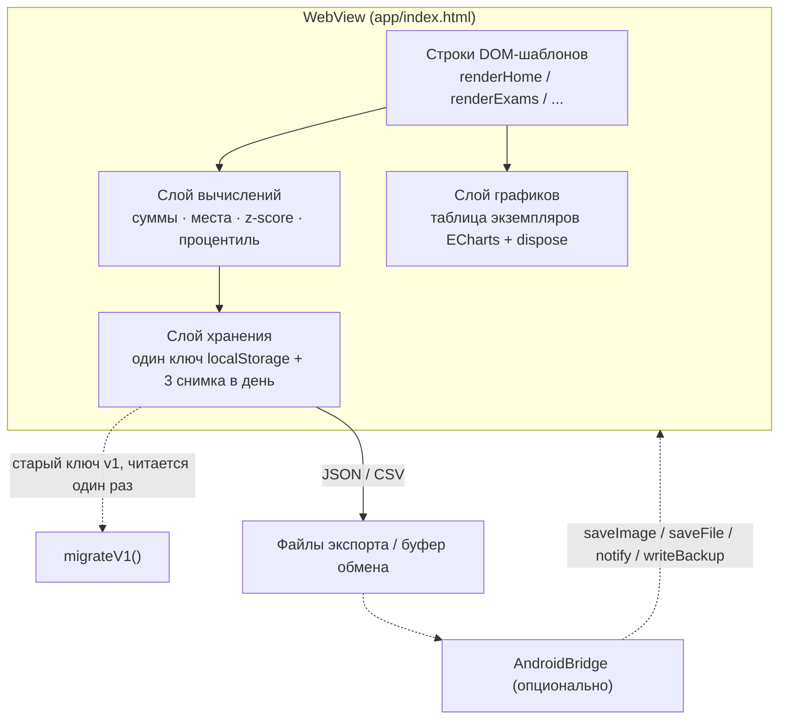

<div align="center">


# GradeTracker

**Полностью офлайн-приложение для учёта оценок на Android — фронтенд из одного HTML-файла в WebView + ювелирная перепаковка APK**

Без регистрации · Без сети · Без телеметрии · Данные остаются только в вашем телефоне

<sub>[简体中文](README.md) · [English](README.en.md) · [日本語](README.ja.md) · [한국어](README.ko.md) · [Español](README.es.md) · **Русский**</sub>

[](LICENSE)
[](https://github.com/axsdfg/GradeTracker/releases/latest)
[](https://github.com/axsdfg/GradeTracker/actions/workflows/ci.yml)
[](#системные-требования)
[-059669.svg)](docs/PRIVACY.md)
[](test/)
[](app/index.html)

</div>

---

> **Язык документации** — это русское издание. Китайское — [README.md](README.md), английское — [README.en.md](README.en.md). Подробные руководства в [`docs/`](docs/) пока только на китайском (переводы приветствуются).
>
> Специфические термины китайского государственного экзамена (гаокао) оставлены с оригиналом: 一分一段 (таблица распределения баллов) · 省控线 (провинциальная контрольная линия) · 赋分 (пересчёт в уровневые баллы).

## Содержание

- [Что это](#что-это)
- [Чем интересно](#чем-интересно)
- [Обзор возможностей](#обзор-возможностей)
- [Структура интерфейса](#структура-интерфейса)
- [Быстрый старт](#быстрый-старт)
- [Данные, резервные копии и приватность](#данные-резервные-копии-и-приватность)
- [Форматы импорта и экспорта](#форматы-импорта-и-экспорта)
- [Структура проекта](#структура-проекта)
- [Архитектура](#архитектура)
- [Сборка и подпись APK](#сборка-и-подпись-apk)
- [Тесты](#тесты)
- [Известные ограничения](#известные-ограничения)
- [Планы](#планы)
- [Участие в проекте](#участие-в-проекте)
- [Лицензия](#лицензия)

---

## Что это

**GradeTracker** — инструмент, которым старшеклассники ведут собственные оценки. Всё приложение — это один HTML-файл (`app/index.html`, около 3000 строк), который работает внутри Android WebView, а все данные записываются в `localStorage`.

Задача вполне конкретна: табель приходит фотографией или сообщением в классном чате, и к концу четверти становится действительно трудно понять «этот предмет улучшается или проседает?». Приложение позволяет записывать каждый экзамен — балл по предмету, место по предмету, общее место — и затем отвечает на три вопроса:

1. Я **расту или отстаю** от экзамена к экзамену? (кривые тренда, ось мест перевёрнута: выше значит лучше)
2. **Какой предмет самый слабый?** (нормировка между предметами и порядок приоритетов для роста балла)
3. **Сколько осталось до цели?** (панель целей с цветовой индикацией разрыва)

Помимо приложения, в репозитории есть **цепочка перепаковки APK, которой не нужны ни Android SDK, ни Gradle**: новый HTML вставляется в уже подписанный APK, бинарный `AndroidManifest.xml` правится на уровне байтов, выравнивание ZIP пересобирается, а затем пакет подписывается заново через `apksig`. Это для случая «на руках только APK, исходного проекта нет».

## Чем интересно

Здесь есть несколько не самых обычных инженерных решений — если вы делаете что-то похожее, они могут пригодиться.

| Решение | Пояснение |
|---|---|
| **Фронтенд в одном файле** | Нет шага сборки, нет `node_modules`, нет фреймворка. Правите строку, сохраняете, обновляете страницу. Цена: модульность держится на договорённостях, а не на `import` |
| **Ноль разрешений = приватность на уровне ОС** | В исходном пакете **нет разрешения `INTERNET`**. Это не обещание «мы ничего не отправляем», а невозможность отправки на уровне операционной системы. Любой код внутри WebView (включая подменённую библиотеку графиков) не имеет доступа к сети |
| **База данных — это localStorage** | Ни Room, ни SQLite. Цена описана в разделе [известные ограничения](#известные-ограничения); выигрыш в том, что резервная копия — это просто JSON |
| **Ювелирная перепаковка** | Ничего не пересобирается: заменяется только `assets/index.html` и правится манифест, остальные 395 записей ZIP остаются побайтово идентичными оригиналу |
| **Интерфейс работает в Node** | Всё приложение выполняется в Node на минимальной заглушке DOM, и все 34 шага регрессии проходят — логику можно проверить без браузера |

## Обзор возможностей

Обозначения: ✅ реализовано ｜ ⚠️ есть резервный путь ｜ ❌ нужна нативная часть, интерфейс во фронтенде уже есть

### Учёт оценок

| Возможность | Статус | Пояснение |
|---|---|---|
| Запись экзаменов | ✅ | Название, дата, тип (месячный, промежуточный, итоговый, пробный…), общее место в классе и в параллели, заметки |
| Балл и место по предмету | ✅ | 9 настраиваемых предметов (3 основных + 3 из 6 по выбору), максимальный балл по каждому, место по предмету в классе и параллели |
| Видимость предметов | ✅ | Ненужные предметы скрываются и исключаются из статистики и графиков |
| Архив по семестрам | ✅ | Экзамен относится к семестру, переключатель в шапке; создание, переименование и удаление пустых семестров |
| Автоматическая миграция | ✅ | При открытии данные v1 (`grade_tracker_data`) переносятся в структуру v2; старый ключ **сохраняется и не удаляется** |

### Аналитика

| Возможность | Статус | Пояснение |
|---|---|---|
| Тренд мест / кривая прогресса | ✅ | Линия по общему баллу или предмету (с пунктиром максимума); две линии — место в классе и в параллели, ось перевёрнута |
| Сильные и слабые предметы | ✅ | Доля от максимума как межпредметный нормализатор; горизонтальные полосы и порядок приоритетов для роста балла |
| Радар способностей | ✅ | Текущий экзамен против личного среднего — перекос виден сразу |
| Достижение целей | ✅ | Целевой балл против фактического по предмету, разрыв со знаком, полоса прогресса, число предметов в цели |
| Пересчёт балла в место | ✅ | Балл → место, число учеников с тем же баллом, диапазон мест, обойденный процентиль; сравнение с контрольными линиями; пересчёт к шкале 750 |
| Режим для родителей | ✅ | Скрывает места и диапазоны, оставляя только баллы и тренды |

### Записи и инструменты

| Возможность | Статус | Пояснение |
|---|---|---|
| Тетрадь ошибок | ✅ | Предмет / связанный экзамен / категория ошибки / исправление / метки / степень освоения, с поиском и фильтрами (только текст, без изображений) |
| Картинка табеля | ✅ | Рисуется на canvas 1080×1500, сохраняется одним нажатием (нативный мост кладёт в галерею, иначе — скачивание браузером) |
| Режимы подсчёта | ✅ | Сырой / взвешенный (Σ балл × вес) / пересчитанный (доля от максимума, отображённая на настраиваемый диапазон) |
| Обратный отсчёт до экзамена | ✅ | Отсчёт на главном экране и полосы напоминаний за 3/7/14/30 дней (системные уведомления требуют нативного моста, иначе напоминание внутри страницы) |
| Тёмная тема | ✅ | Как в системе / светлая / тёмная, цвета графиков переключаются синхронно |
| Язык интерфейса | ✅ | 简体中文 / English / 日本語 / 한국어 / Español / Русский — переключается в настройках или следует системе. Графики, карточка оценок и всплывающие сообщения тоже переводятся |
| Экспорт данных | ✅ | Полная резервная копия JSON и детализация баллов в CSV (с BOM, Excel открывает напрямую) |
| Импорт таблиц | ✅ | Вставка из Excel/WPS (TSV) или CSV; строки с одинаковой датой и названием объединяются в один экзамен |
| Автоматическое резервирование | ✅ | Три снимка в день на устройстве (кольцевой буфер), плюс пять файлов при наличии нативного моста |
| Виджет главного экрана | ❌ | Чисто нативная возможность (Glance / AppWidget) |
| Фото ошибок | ❌ | Нужны разрешение камеры и хранение изображений; картинки переполнят квоту localStorage |

## Структура интерфейса

Пять вкладок внизу, все внутри одного HTML-файла, переключаются через `switchView()`:

| Вкладка | Содержимое |
|---|---|
| **Главная** | Общий балл текущего семестра, изменение с прошлого экзамена, панель целей, тренд общего балла, обратный отсчёт |
| **Экзамены** | Список экзаменов (с фильтром по семестру) → подробности (балл, место, сравнение с классом по предметам) |
| **Аналитика** | Три подвкладки: тренд / сила-слабость / места |
| **Ошибки** | Карточки ошибок с фильтрами по предмету и степени освоения |
| **Настройки** | Предметы, веса и пересчёт, семестры, источник данных, экспорт/импорт, тема, режим для родителей |

## Быстрый старт

### Вариант 1: скачать APK

[**Скачать последнюю версию APK**](https://github.com/axsdfg/GradeTracker/releases/latest) · 3,37 МиБ · Android 7.0+ · шесть языков интерфейса

При первой установке нужно разрешить «приложения из неизвестных источников». Пакет подписан **отладочным сертификатом**: для установки на свой телефон подходит, но как официальная сборка не рекомендуется. Для долгосрочного сопровождения соберите его сами с релизным ключом (вариант 3).

> Подпись та же, что у предыдущей версии, поэтому установка поверх не удалит уже записанные оценки. Контрольные суммы — на странице [Releases](https://github.com/axsdfg/GradeTracker/releases).

### Вариант 2: собрать устанавливаемый APK самостоятельно

Нужны **существующий APK** (в роли оболочки) и JDK 17:

```bash
# 1. Заменить фронтенд и пропатчить манифест, получить неподписанный пакет
python tools/apk_repack.py original.apk app/index.html unsigned.apk

# 2. Подписать заново (v1 + v2 + v3)
java tools/SignApk.java sign my.jks <storepass> <alias> unsigned.apk signed.apk 21

# 3. Проверить
java tools/SignApk.java verify signed.apk      # ожидается verified = true, v1/v2/v3 тоже true
```

Подробности, подводные камни и изменения манифеста — в **[docs/PACKAGING.md](docs/PACKAGING.md)** (китайский).

### Вариант 3: встроить в свой Android-проект

Положите `app/index.html` в `app/src/main/assets/`, загрузите через `WebViewAssetLoader` (стабильнее, чем `file://`) и подключите JS-мост:

```java
webView.addJavascriptInterface(new Bridge(this), "AndroidBridge");
webView.loadUrl("https://appassets.androidplatform.net/assets/index.html");
```

Полная эталонная реализация нативной оболочки (14 КБ: выбор файлов, загрузки, сохранение изображений, уведомления, кнопка «назад») — в **[android/MainActivity.java](android/MainActivity.java)**; изменения манифеста и разрешения описаны в **[docs/ANDROID-INTEGRATION.md](docs/ANDROID-INTEGRATION.md)** (китайский).

### Вариант 4: запуск в браузере (разработка)

```bash
node scripts/fetch-vendor.js
node scripts/build-preview.js      # создаёт dist/preview.html (ECharts встроен в один файл)
# двойной щелчок по dist/preview.html
```

Можно открыть и `app/index.html` напрямую (рядом должен лежать `app/echarts.min.js`).

> `localStorage` в браузере разделён по источникам, поэтому `file://` и `http://localhost` не видят данные друг друга. Учитывайте это при отладке.

### Зависимость: ECharts

В репозитории **нет** `echarts.min.js` (1 МБ стороннего минифицированного кода уместнее брать с CDN). Выполните один раз перед первым запуском:

```bash
node scripts/fetch-vendor.js        # скачает ECharts 5.6.0 в app/echarts.min.js
```

Либо скачайте [echarts@5.6.0/dist/echarts.min.js](https://cdn.jsdelivr.net/npm/echarts@5.6.0/dist/echarts.min.js) вручную и сохраните как `app/echarts.min.js`.

> Используются только `line / bar / radar / tooltip`. Для меньшего размера возьмите официальную онлайн-сборку ECharts: около 300 КБ, а первый рендер примерно вдвое быстрее.

### Системные требования

- WebView 55+ (используется `async/await`), на практике это **Android 7.0+**
- `minSdk` в манифесте равен 21, но на устройствах ниже 7.0 страница останется белой

## Данные, резервные копии и приватность

| Пункт | Значение |
|---|---|
| Место хранения | `localStorage` WebView (`/data/data/<пакет>/app_webview/Local Storage/`) |
| Основной ключ | `grade_tracker_v2` |
| Устаревший ключ | `grade_tracker_data` (**не удаляется** после миграции) |
| Ежедневные снимки | `grade_tracker_bak_0/1/2`, кольцевой буфер на 3 дня |
| Копии на диске | При наличии `AndroidBridge.writeBackup` — ещё 5 копий в `files/backups/` |
| Формат | JSON в открытом виде |

**Работа с сетью**: во всём фронтенде ровно **один** вызов `fetch()` (`checkScoreDataUpdate`), и он срабатывает только если вы указали адрес источника данных в настройках и нажали «Получить сейчас», либо если включено автообновление и прошло больше 24 часов. Ни аналитики, ни отчётов о сбоях, ни сторонних SDK, ни удалённой отладки WebView.

**О разрешении `INTERNET`**: исходный APK его не запрашивает, поэтому «данные не могут уйти» — гарантия уровня ОС. Добавление разрешения понижает её до «код ведёт себя прилично». Компромисс разобран в [docs/PRIVACY.md](docs/PRIVACY.md); по умолчанию рекомендуется оставлять ноль разрешений и пользоваться импортом.

> ⚠️ **localStorage хранится в открытом виде**. С `android:allowBackup="false"` и `debuggable=false` обычными средствами его не прочитать, но на устройстве с root или при физическом доступе — можно. Не храните здесь номера документов и подобные данные.

## Форматы импорта и экспорта

### Импорт таблицы оценок (TSV / CSV)

Скопируйте блок ячеек прямо из Excel/WPS и вставьте; строки с одинаковыми `日期` (дата) и `考试名称` (название экзамена) автоматически объединяются в один экзамен:

```csv
日期,考试名称,科目,分数,满分,班排,年排
2026-09-28,第一次月考,语文,112,150,8,45
2026-09-28,第一次月考,数学,134,150,5,31
```

> Названия столбцов сопоставляются **по-китайски**. Не переводите их. `满分` (максимум), `班排` (место в классе) и `年排` (место в параллели) можно опустить.

### Данные распределения баллов (JSON)

```json
{
  "province": "浙江",
  "year": 2025,
  "subjectType": "普通类",
  "version": "2025.06",
  "controlLines": [
    { "name": "特殊类型招生控制线", "score": 592 },
    { "name": "一段线", "score": 495 }
  ],
  "segments": [
    { "score": 700, "count": 12, "cumulative": 120 },
    { "score": 699, "count": 25, "cumulative": 145 }
  ]
}
```

`segments` сортируется по баллу **по убыванию**; если `cumulative` не указан, он накапливается автоматически.

> Встроенные примеры данных **синтетические**, и интерфейс, и результаты помечены «пример данных · не пригоден для реальной подачи документов». Реальные данные нужно экспортировать из провинциальной экзаменационной комиссии и импортировать вручную.

### Резервные копии

«Экспорт копии» в настройках создаёт полный JSON; «Импорт копии» восстанавливает его на другом устройстве. Внутри WebView `<a download>` часто не работает, поэтому при отсутствии нативного сохранения показывается **текстовое поле с возможностью выделить всё** — данные как минимум можно вынести.

## Структура проекта

```
GradeTracker/
├── app/
│   ├── index.html                 # само приложение (один файл, ~3000 строк)
│   ├── README.md                  # заметки по фронтенду
│   └── legacy/
│       └── index.v1.original.html # оригинал v1, для сравнения и миграции
├── android/
│   ├── MainActivity.java          # эталонная нативная оболочка
│   └── res/xml/                   # network_security_config, data_extraction_rules
├── tools/
│   ├── apk_repack.py              # перепаковка: замена assets + патч AXML + выравнивание
│   ├── axml.py                    # разбор бинарного AndroidManifest.xml
│   ├── SignApk.java               # подпись и проверка apksig v1+v2+v3 (один файл, JDK 17)
│   ├── dexinfo.py                 # опись классов и методов DEX
│   └── disasm.py                  # минимальный дизассемблер Dalvik
├── test/
│   ├── harness.js                 # заглушка DOM + 34 шага регрессии
│   └── migrate_test.js            # проверки миграции v1 → v2 (18)
├── scripts/
│   ├── fetch-vendor.js            # загрузка ECharts
│   └── build-preview.js           # сборка предпросмотра в один файл
├── docs/
│   ├── ARCHITECTURE.md            # модель данных, конвейер рендеринга, жизненный цикл графиков
│   ├── FEATURES.md                # детали возможностей и резервные пути
│   ├── PACKAGING.md               # перепаковка и подпись APK подробно
│   ├── ANDROID-INTEGRATION.md     # манифест, разрешения, настройки сети, JS-мост
│   ├── PRIVACY.md                 # потоки данных и модель угроз
│   ├── ROADMAP.md                 # дальнейшее развитие
│   ├── TRANSLATIONS.md            # состояние переводов и как добавить язык
│   └── apk-analysis-report.html   # статический анализ реального APK (пример)
├── assets/logo.svg
└── .github/workflows/ci.yml
```

## Архитектура



Ключевые решения:

- **Однонаправленный рендеринг**: `state` — единственный источник истины; `switchView()` → `renderXxx()` → сборка HTML-строки → `innerHTML`. Виртуальный DOM не нужен и не требуется.
- **Жизненный цикл графиков**: в ранних версиях при каждом `renderHome` создавался `new ResizeObserver` без отписки, поэтому после десятка переключений накапливалась утечка. Сейчас есть таблица `charts` и один глобальный слушатель `resize`, а при смене экрана вызывается `dispose`.
- **Ввод не прерывается**: поле поиска перерисовывает только контейнер списка, а не всю страницу (иначе ломается композиция китайской IME).
- **Сдерживание XSS**: любой пользовательский ввод и импортированное содержимое проходят через `esc()` до попадания в шаблон.
- **Прогрессивное улучшение**: каждая нативная возможность написана как «нет моста — деградируем», поэтому в обычном браузере приложение полностью работоспособно (кроме сохранения в галерею и системных уведомлений).

Подробности — в **[docs/ARCHITECTURE.md](docs/ARCHITECTURE.md)** (китайский).

## Сборка и подпись APK

`tools/apk_repack.py` обходит Gradle и правит пакет на уровне байтов ZIP:

1. Заменяет запись `assets/index.html` новой;
2. Разбирает бинарный `AndroidManifest.xml` (пул строк AXML + элементы + атрибуты), ставит `debuggable` / `allowBackup` / `usesCleartextTraffic` в `false` и увеличивает `versionCode` на 1;
3. Если нужна сеть, добавляет `android.permission.INTERNET` в конец пула строк и вставляет узел `<uses-permission>` (существующие индексы строк не меняются);
4. Пересобирает выравнивание по 4 байта для записей `method=0` (stored), что эквивалентно `zipalign`, остальные записи остаются побайтово прежними;
5. Удаляет старые файлы подписи v1 и передаёт пакет в `SignApk.java` для переподписи v1+v2+v3 через `apksig`.

Три частые ловушки (все обработаны в коде, см. [docs/PACKAGING.md](docs/PACKAGING.md)):

- Начальное смещение атрибутов AXML — `pos + 16 + attributeStart`, а не `pos + 24`;
- В некоторых исходных пакетах поле `extra` содержит недопустимое двухбайтовое заполнение нулями, которое нужно отбрасывать;
- Выравнивание ZIP считается по **абсолютному смещению** `len(out) + 30 + nlen`, а не по смещению внутри записи.

`SignApk.java` — один файл без зависимостей (достаточно `apksig.jar` в classpath), запускается в режиме одиночного исходника JDK 17:

```bash
java -cp apksig.jar tools/SignApk.java verify signed.apk
```

> `apksig.jar` (официальная библиотека подписи Google, около 500 КБ) и ваш keystore **не входят** в репозиторий: первое берётся из Maven, второе — ваш личный ключ.

## Тесты

Логику можно проверять без браузера: `test/harness.js` запускает всё приложение в Node на минимальной заглушке DOM.

```bash
node test/harness.js          # 34 шага регрессии (рендер, импорт/экспорт, тема, кнопка «назад»…)
node test/harness.js --dump   # плюс сводка состояния и результата рендера для ручной проверки
node test/migrate_test.js     # миграция v1 → v2, 18 проверок
```

CI (`.github/workflows/ci.yml`) запускает обе команды на каждый push, а также проверку «офлайн-гарантии»: в `app/index.html` не должно быть открытых адресов `http://` и внешних `<script src="http...">`.

**Не покрыто**: реальный рендеринг, жесты касания и попиксельный вид картинки табеля. Это проверяется только на устройстве или в браузере.

## Известные ограничения

- **Одно устройство**: данные живут только в телефоне, без синхронизации и облачных копий. Переход на новое устройство — экспорт и импорт JSON.
- **Ёмкость localStorage**: около 5 МБ, и это синхронный API. При больших объёмах (десятки тысяч ошибок) будут подтормаживания.
- **Хранение в открытом виде**: см. раздел о приватности.
- **Пересчёт баллов — упрощённая модель**: линейное отображение доли от максимума, а не реальные правила уровневого пересчёта каждой провинции. Для реальных правил нужны провинциальные таблицы диапазонов.
- **Данные распределения баллов ищите сами**: у экзаменационных комиссий нет открытого API, встроенные данные синтетические.
- **Половина системной интеграции отсутствует**: виджет главного экрана, фото ошибок и системные уведомления требуют нативной части; во фронтенде есть только интерфейсы.
- **Ограниченная проверка на устройствах**: в исходной среде разработки не было пригодного движка браузера, поэтому логика гарантирована набором регрессионных тестов; внешний вид и жесты проверяйте на реальном устройстве.

## Планы

См. [docs/ROADMAP.md](docs/ROADMAP.md). Три самых ценных пункта на ближайшее время:

1. Заменить линейное приближение реальными правилами уровневого пересчёта каждой провинции;
2. Разделить `index.html` на несколько файлов в `src/` плюс 30-строчный скрипт склейки (сохранив плюс «без сборки» и вернув сопровождаемость);
3. Добавить дымовой тест на Playwright, покрывающий реальный путь рендеринга.

## Участие в проекте

Issues и PR приветствуются, особенно отчёты о совместимости с реальными устройствами, провинциальные правила пересчёта баллов и адаптация других форматов данных распределения. Сначала прочитайте [CONTRIBUTING.md](CONTRIBUTING.md) (китайский).

О добавлении языков — см. [docs/TRANSLATIONS.md](docs/TRANSLATIONS.md): новые языки называются `README.<код>.md` и добавляются в переключатель языка во всех README.

## Лицензия

[MIT](LICENSE) © 2026 axsdfg

ECharts публикуется Apache Software Foundation под лицензией Apache-2.0 и не распространяется вместе с этим репозиторием.

---

<sub>[简体中文](README.md) · [English](README.en.md) · [日本語](README.ja.md) · [한국어](README.ko.md) · [Español](README.es.md) · **Русский**</sub>
